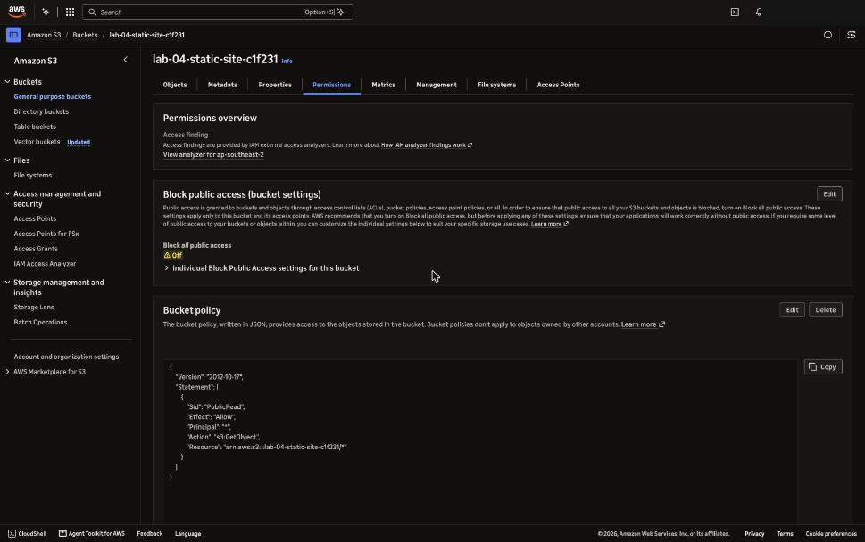
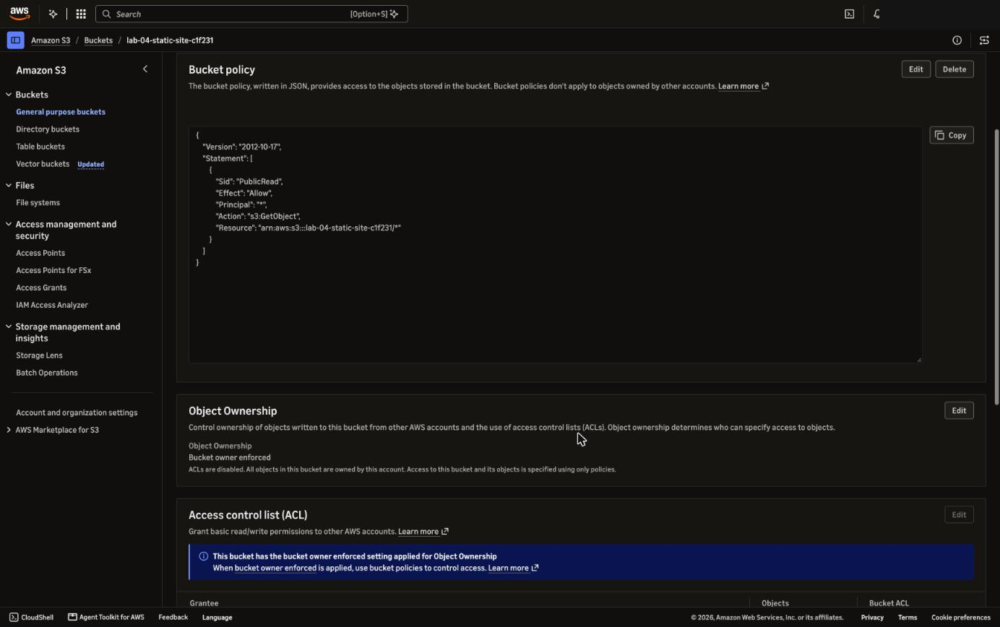
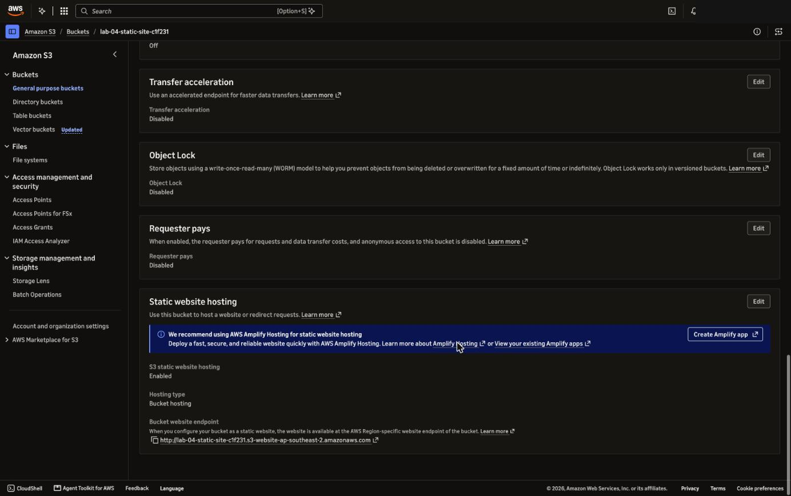
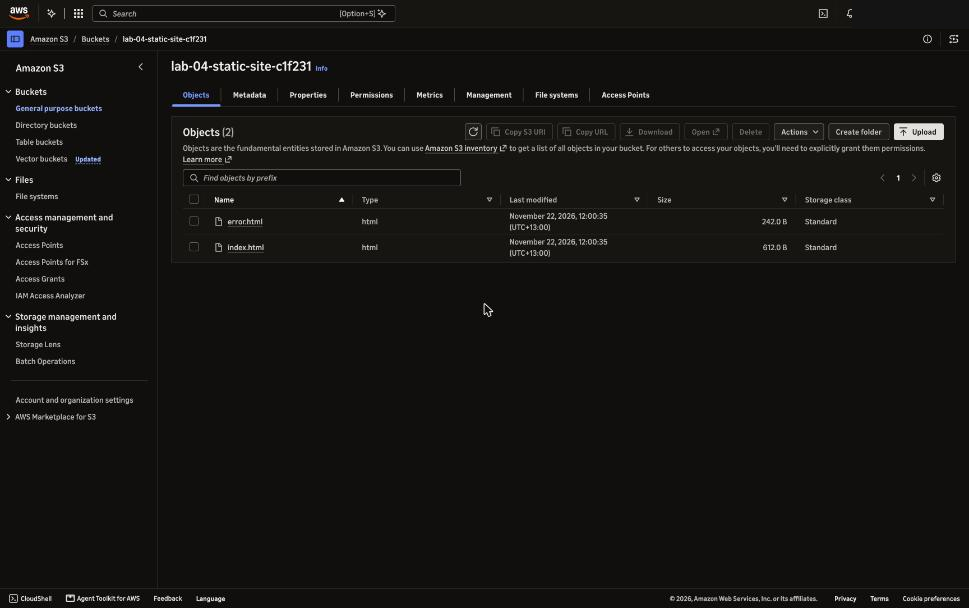

# 04 - S3 Static Website

**Level:** Beginner | **Time:** ~15 min | **Cost:** about $0 (a few KB in S3, inside the free tier) | **Region:** `ap-southeast-2` (Sydney)

**Live demo:** http://lab-04-static-site-c1f231.s3-website-ap-southeast-2.amazonaws.com
(Real, running in my AWS account. Try a bad path like `/nope` to see the custom 404 page.)

## What you'll build
A public website hosted entirely on Amazon S3. There are no servers and no web framework: you upload an `index.html` and S3 serves it over HTTP, with a custom 404 page.

## Architecture
See [architecture.md](architecture.md).

## Services used
- [Amazon S3](https://docs.aws.amazon.com/AmazonS3/latest/userguide/WebsiteHosting.html) - object storage with a built-in static website mode
- [S3 bucket policies](https://docs.aws.amazon.com/AmazonS3/latest/userguide/bucket-policies.html) - JSON rules saying who can read which objects

## Prerequisites
- An AWS account and the AWS CLI configured (`aws sts get-caller-identity` works)
- `openssl` (random bucket-name suffix; already on macOS and Linux)

## Steps
Each step shows the **console** way (click path) and the **CLI** way. [`scripts/deploy.sh`](scripts/deploy.sh) runs all five CLI steps in order. The screenshots below were taken from the AWS console after building, and show the state each step produces. Account name and ID are blacked out.

### Step 1 - Create the bucket
Bucket names are global across all AWS accounts, so add a random suffix.

- **Console:** [S3 → Buckets → Create bucket](https://s3.console.aws.amazon.com/s3/bucket/create) → name `lab-04-static-site-<suffix>` → Region `ap-southeast-2` → leave the rest as default → **Create bucket**
- **CLI:**
```bash
aws s3api create-bucket --bucket lab-04-static-site-<suffix> --region ap-southeast-2 \
  --create-bucket-configuration LocationConstraint=ap-southeast-2
```

### Step 2 - Allow public reads on this bucket only
New buckets block all public access (a good default). For a public website you turn off only the two *policy* blocks, and only for this bucket. The two ACL blocks stay on.

- **Console:** bucket → **Permissions** → **Block public access (bucket settings)** → **Edit** → untick *Block public access to buckets and objects granted through new public bucket or access point policies* and *...through any public bucket or access point policies* → **Save changes**
- **CLI:**
```bash
aws s3api put-public-access-block --bucket <bucket> --public-access-block-configuration \
  BlockPublicAcls=true,IgnorePublicAcls=true,BlockPublicPolicy=false,RestrictPublicBuckets=false
```

*"Block all public access: Off" is expected, because two of the four blocks are now off.*

### Step 3 - Add a read-only bucket policy
This grants only `s3:GetObject` (read). Nobody can list, upload or delete.

- **Console:** bucket → **Permissions** → **Bucket policy** → **Edit** → paste the JSON below → **Save changes**
- **CLI:** `aws s3api put-bucket-policy --bucket <bucket> --policy file://policy.json`
```json
{"Version":"2012-10-17","Statement":[{"Sid":"PublicRead","Effect":"Allow",
 "Principal":"*","Action":"s3:GetObject","Resource":"arn:aws:s3:::<bucket>/*"}]}
```


### Step 4 - Turn on static website hosting
- **Console:** bucket → **Properties** → scroll to **Static website hosting** → **Edit** → **Enable** → Index document `index.html`, Error document `error.html` → **Save changes**
- **CLI:**
```bash
aws s3api put-bucket-website --bucket <bucket> --website-configuration \
  '{"IndexDocument":{"Suffix":"index.html"},"ErrorDocument":{"Key":"error.html"}}'
```

*The "Bucket website endpoint" at the bottom is your site's URL.*

### Step 5 - Upload the site files
- **Console:** bucket → **Objects** → **Upload** → **Add files** (`src/index.html`, `src/error.html`) → **Upload**
- **CLI:**
```bash
aws s3 sync src/ s3://<bucket>/
```


## Verify in AWS
Tick each box. A reviewer can do the same with the live link and read-only access.

- [ ] **Live site:** open the live demo URL above. You see *"Hello from Amazon S3"*.
- [ ] **Custom 404:** open `<url>/nope`. You see *"404 - Page not found"*.
- [ ] **Bucket exists in Sydney:** S3 console → bucket `lab-04-static-site-c1f231` → region *Asia Pacific (Sydney)*. CLI: `aws s3api get-bucket-location --bucket lab-04-static-site-c1f231`
- [ ] **Website hosting is on:** bucket → Properties → *S3 static website hosting: Enabled*. CLI: `aws s3api get-bucket-website --bucket lab-04-static-site-c1f231`
- [ ] **Policy allows reads only:** bucket → Permissions → policy has only `s3:GetObject`. CLI: `aws s3api get-bucket-policy --bucket lab-04-static-site-c1f231`
- [ ] **Two files stored:** bucket → Objects shows `index.html` and `error.html`.

Command-line proof captured when I built it: [`verify-output.txt`](verify-output.txt)
```
GET /      -> 200  <h1>Hello from Amazon S3</h1>
GET /nope  -> 404  <h1>404 - Page not found</h1>
```

## Clean up
See [cleanup.md](cleanup.md). This lab is left running for demonstration; deleting it is one command.

## What I learned / common errors
- **`AccessDenied` on the website URL:** the bucket policy is missing, or Block Public Access still has `BlockPublicPolicy` on.
- **`BucketAlreadyExists`:** bucket names are global, so add a random suffix.
- **Website endpoints are HTTP only.** For HTTPS and a CDN, see Lab 06 (CloudFront in front of S3).
- Public access is set per bucket, not account-wide, to keep the blast radius small.
