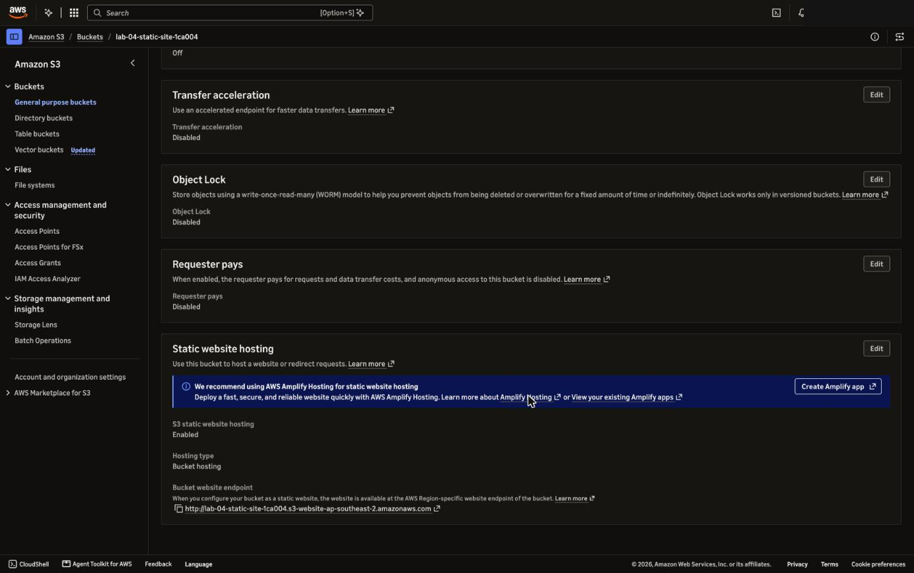
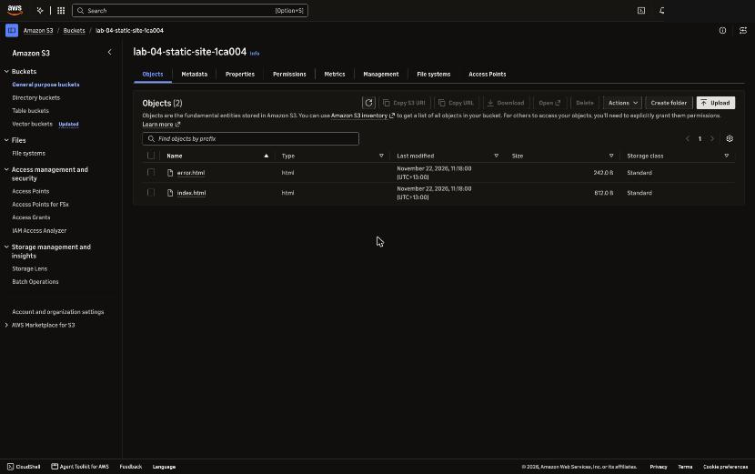

# 04 - S3 Static Website

**Level:** Beginner | **Time:** ~15 min | **Cost:** about $0 (a few KB in S3, well inside the free tier) | **Region:** `ap-southeast-2`

## What you'll build
A public website hosted entirely on Amazon S3: no servers, no web framework. You upload an `index.html` and S3 serves it over HTTP, with a custom 404 page.

## Architecture
See [architecture.md](architecture.md).

## Services used
- [Amazon S3](https://docs.aws.amazon.com/AmazonS3/latest/userguide/WebsiteHosting.html) - object storage with a built-in static website mode
- [S3 bucket policies](https://docs.aws.amazon.com/AmazonS3/latest/userguide/bucket-policies.html) - JSON rules saying who can read which objects

## Prerequisites
- An AWS account and the AWS CLI configured: `aws sts get-caller-identity` works
- `openssl` (to make a random bucket-name suffix; already on macOS/Linux)

## Steps

Fastest path: run [`scripts/deploy.sh`](scripts/deploy.sh). The manual steps below explain what it does.

### 1. Create the bucket
Bucket names are global, so add a random suffix.
Console: [S3 → Create bucket](https://s3.console.aws.amazon.com/s3/bucket/create)
```bash
aws s3api create-bucket --bucket lab-04-static-site-<suffix> --region ap-southeast-2 \
  --create-bucket-configuration LocationConstraint=ap-southeast-2
```

### 2. Allow public reads on this bucket only
New buckets block public access by default (a good thing). For a public website you relax only the policy-related blocks on this one bucket.
Console: bucket → **Permissions → Block public access → Edit**
```bash
aws s3api put-public-access-block --bucket <bucket> --public-access-block-configuration \
  BlockPublicAcls=true,IgnorePublicAcls=true,BlockPublicPolicy=false,RestrictPublicBuckets=false
```

### 3. Add a read-only bucket policy
Only `s3:GetObject` (read) is granted, so nobody can list, write or delete.
```json
{"Version":"2012-10-17","Statement":[{"Sid":"PublicRead","Effect":"Allow",
 "Principal":"*","Action":"s3:GetObject","Resource":"arn:aws:s3:::<bucket>/*"}]}
```

### 4. Turn on static website hosting
Console: bucket → **Properties → Static website hosting → Edit → Enable**
```bash
aws s3api put-bucket-website --bucket <bucket> --website-configuration \
  '{"IndexDocument":{"Suffix":"index.html"},"ErrorDocument":{"Key":"error.html"}}'
```


### 5. Upload the site
Console: bucket → **Objects → Upload**
```bash
aws s3 sync src/ s3://<bucket>/
```


## Verify it works
The endpoint is `http://<bucket>.s3-website-ap-southeast-2.amazonaws.com`. Result from my run:

```
$ curl -s -o /dev/null -w "%{http_code}" <endpoint>/        -> 200   (<h1>Hello from Amazon S3</h1>)
$ curl -s -o /dev/null -w "%{http_code}" <endpoint>/nope    -> 404   (custom error.html served)
```

## Clean up
See [cleanup.md](cleanup.md). I ran `scripts/cleanup.sh` after testing.

## What I learned / common errors
- **`AccessDenied` on the website URL:** the bucket policy is missing, or Block Public Access still has `BlockPublicPolicy` on.
- **`BucketAlreadyExists`:** bucket names are global across all AWS accounts, so add a random suffix.
- **Website endpoints are HTTP only.** For HTTPS and a CDN, see Lab 06 (CloudFront in front of S3).
- Public access is configured per bucket, not for the whole account, to keep the blast radius small.
