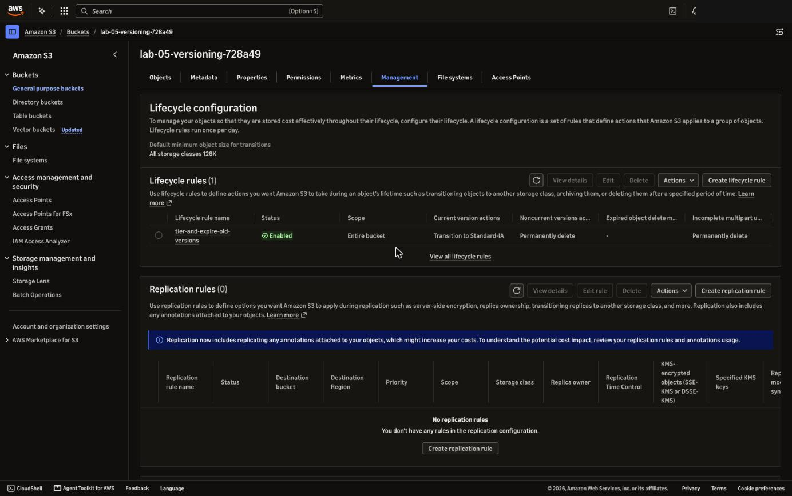

# 05 - S3 Versioning and Lifecycle Rules

**Level:** Beginner | **Time:** ~20 min | **Cost:** about $0 (a few bytes stored) | **Region:** `ap-southeast-2`

## What you'll build
A bucket that **keeps every version of a file**, survives an accidental delete (you recover it), and automatically moves old data to cheaper storage and expires old versions after 30 days.

## Architecture
```
 put report.txt ×3 ──▶ [ Bucket, versioning ON ] ──▶ v1, v2, v3 (v3 = current)
 delete report.txt  ──▶ adds a "delete marker" (v1-v3 still there)
 delete the marker  ──▶ report.txt is back
 Lifecycle rule: current objects → STANDARD_IA at 30 days; old versions deleted after 30 days
```

## Services used
- [S3 Versioning](https://docs.aws.amazon.com/AmazonS3/latest/userguide/Versioning.html) - keeps every version of an object
- [S3 Lifecycle](https://docs.aws.amazon.com/AmazonS3/latest/userguide/object-lifecycle-mgmt.html) - automatic transitions and expiry

## Prerequisites
AWS CLI configured (`aws sts get-caller-identity` works).

## Steps
Run everything with [`scripts/deploy.sh`](scripts/deploy.sh); real output is saved in [`sample-output.txt`](sample-output.txt).

### 1. Create the bucket
Console: [S3 → Create bucket](https://s3.console.aws.amazon.com/s3/bucket/create) (leave Block Public Access ON).

### 2. Enable versioning
Console: bucket → **Properties → Bucket Versioning → Edit → Enable**
```bash
aws s3api put-bucket-versioning --bucket <bucket> --versioning-configuration Status=Enabled
```

### 3. Upload the same key three times
```bash
aws s3api put-object --bucket <bucket> --key report.txt --body report.txt
```
`list-object-versions` now shows three versions; only one is `IsLatest`.

### 4. Delete the file, then recover it
A normal delete does not erase data; it adds a **delete marker**, and `get-object` now returns `NoSuchKey`. Delete the marker and the file returns, with the latest content (`report version 3`).
```bash
aws s3api delete-object --bucket <bucket> --key report.txt                       # adds marker
aws s3api delete-object --bucket <bucket> --key report.txt --version-id <marker> # recovers
```
Console: bucket → **Objects → Show versions** toggle.

### 5. Add a lifecycle rule
[`src/lifecycle.json`](src/lifecycle.json): move to Standard-IA after 30 days, delete non-current versions after 30 days, abort stale multipart uploads after 7 days.

Console: bucket → **Management → Create lifecycle rule**
```bash
aws s3api put-bucket-lifecycle-configuration --bucket <bucket> --lifecycle-configuration file://src/lifecycle.json
```


## Verify it works
See [`sample-output.txt`](sample-output.txt): three versions listed, `NoSuchKey` after the delete, `restored content: report version 3`, and the lifecycle rule printed back as `Enabled`.

## Clean up
See [cleanup.md](cleanup.md).

## What I learned / common errors
- **Versioned buckets can't be deleted until every version and delete marker is gone.** Emptying only the current objects is not enough; the cleanup script removes versions and markers explicitly.
- **Versioning costs storage:** every version is billed. That is why the lifecycle rule expires old versions.
- Lifecycle rules run about once a day, so the transition and expiry can't be demonstrated within minutes. I verified the rule is stored and Enabled, not that it has fired.
- Once enabled, versioning can only be suspended, never fully switched off.
