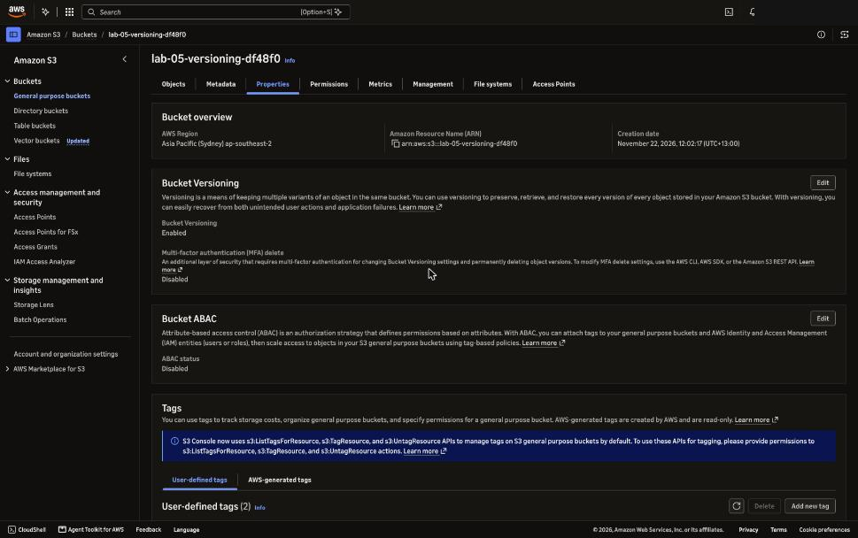
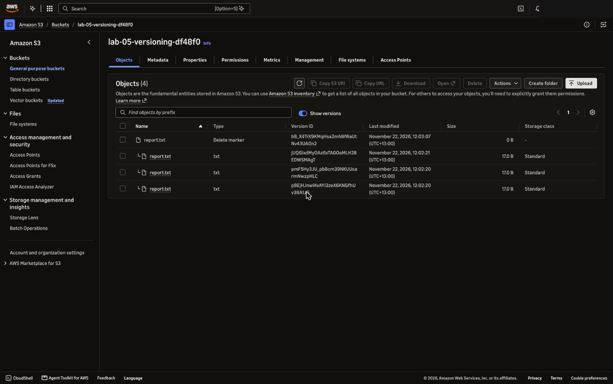
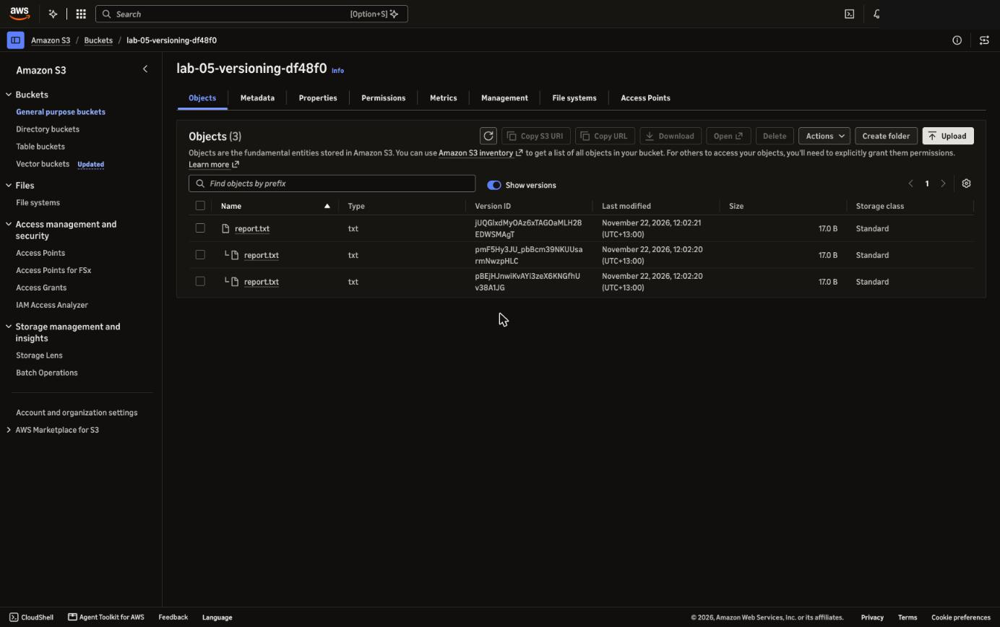
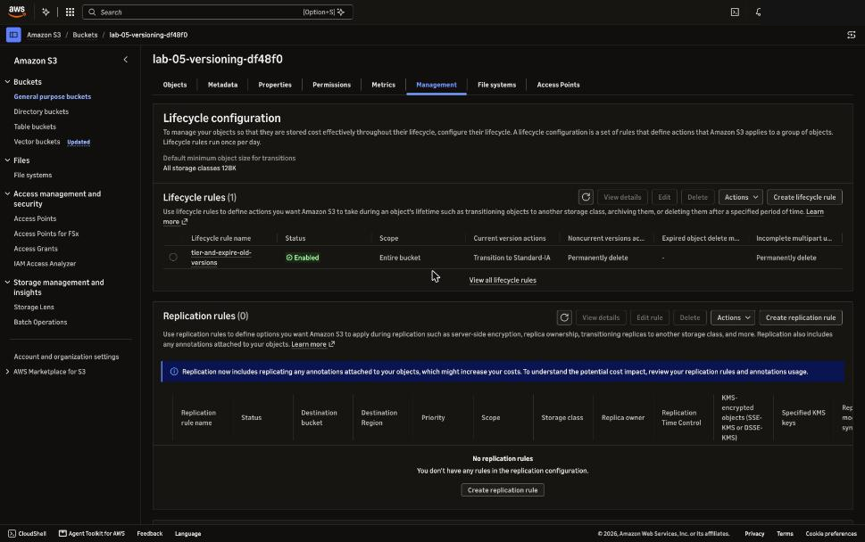

# 05 - S3 Versioning and Lifecycle Rules

**Level:** Beginner | **Time:** ~20 min | **Cost:** about $0 (51 bytes stored) | **Region:** `ap-southeast-2` (Sydney)

**Live in AWS:** bucket `lab-05-versioning-df48f0` (private; verify it with the checklist below, there is no public URL for this one)

## What you'll build
A bucket that **keeps every version of a file**, survives an accidental delete (you recover it), and automatically moves old data to cheaper storage and expires old versions after 30 days.

## Architecture
```
 put report.txt ×3 ──▶ [ Bucket, versioning ON ] ──▶ v1, v2, v3 (v3 = current)
 delete report.txt  ──▶ adds a "delete marker" (v1-v3 still there)
 delete the marker  ──▶ report.txt is back
 Lifecycle rule: current objects → STANDARD_IA at 30 days; old versions deleted after 30 days
```

## Services used
- [S3 Versioning](https://docs.aws.amazon.com/AmazonS3/latest/userguide/Versioning.html) - keeps every version of an object
- [S3 Lifecycle](https://docs.aws.amazon.com/AmazonS3/latest/userguide/object-lifecycle-mgmt.html) - automatic transitions and expiry

## Prerequisites
AWS CLI configured (`aws sts get-caller-identity` works).

## Steps
[`scripts/deploy.sh`](scripts/deploy.sh) runs steps 1-5 in order; the console way is shown for each. Screenshots were taken from the AWS console after each step (account name and ID blacked out). Real command output is in [`sample-output.txt`](sample-output.txt).

### Step 1 - Create the bucket and enable versioning
- **Console:** [S3 → Create bucket](https://s3.console.aws.amazon.com/s3/bucket/create) (leave Block Public Access ON) → then bucket → **Properties** → **Bucket Versioning** → **Edit** → **Enable** → **Save changes**
- **CLI:**
```bash
aws s3api create-bucket --bucket <bucket> --region ap-southeast-2 \
  --create-bucket-configuration LocationConstraint=ap-southeast-2
aws s3api put-bucket-versioning --bucket <bucket> --versioning-configuration Status=Enabled
```


### Step 2 - Upload the same file three times
- **Console:** bucket → **Objects** → **Upload** → choose `report.txt` → repeat with changed content two more times. Then switch on **Show versions**.
- **CLI:**
```bash
aws s3api put-object --bucket <bucket> --key report.txt --body report.txt   # run 3 times
```
Three versions exist; only the newest is the current one.


### Step 3 - Delete the file (this only adds a delete marker)
- **Console:** with **Show versions** off, select `report.txt` → **Delete**. Turn **Show versions** on again.
- **CLI:** `aws s3api delete-object --bucket <bucket> --key report.txt`

A normal delete does **not** erase data. S3 adds a *delete marker* on top, `get-object` now returns `NoSuchKey`, and all three versions are still stored.


### Step 4 - Recover the file
Delete the delete marker itself (by its version ID) and the file comes back.
- **Console:** **Show versions** on → tick the row of type *Delete marker* → **Delete** → type `permanently delete`.
- **CLI:** `aws s3api delete-object --bucket <bucket> --key report.txt --version-id <marker-version-id>`

Content after recovery: `report version 3`.

### Step 5 - Add a lifecycle rule
[`src/lifecycle.json`](src/lifecycle.json): move to Standard-IA after 30 days, delete non-current versions after 30 days, abort stale multipart uploads after 7 days.
- **Console:** bucket → **Management** → **Create lifecycle rule** → name `tier-and-expire-old-versions` → apply to all objects → tick the *transition current versions*, *permanently delete noncurrent versions* and *delete incomplete multipart uploads* actions → **Create rule**
- **CLI:**
```bash
aws s3api put-bucket-lifecycle-configuration --bucket <bucket> --lifecycle-configuration file://src/lifecycle.json
```


## Verify in AWS
- [ ] **Versioning on:** S3 → `lab-05-versioning-df48f0` → Properties → *Bucket Versioning: Enabled*. CLI: `aws s3api get-bucket-versioning --bucket lab-05-versioning-df48f0` → `"Status": "Enabled"`
- [ ] **Three versions:** Objects → toggle **Show versions** → three `report.txt` rows with different Version IDs. CLI: `aws s3api list-object-versions --bucket lab-05-versioning-df48f0 --query 'Versions[].VersionId'` → 3 IDs
- [ ] **File is recoverable and current:** `aws s3 cp s3://lab-05-versioning-df48f0/report.txt -` → `report version 3`
- [ ] **Lifecycle rule exists and is Enabled:** Management tab → rule `tier-and-expire-old-versions`. CLI: `aws s3api get-bucket-lifecycle-configuration --bucket lab-05-versioning-df48f0`
- [ ] **Bucket is private:** Permissions → *Block all public access: On*

Command output captured from the live bucket: [`verify-output.txt`](verify-output.txt)

## Clean up
See [cleanup.md](cleanup.md). This lab is left running for demonstration.

## What I learned / common errors
- **Versioned buckets can't be deleted until every version and delete marker is gone.** Emptying only the current objects is not enough; the cleanup script removes versions and markers explicitly.
- **Versioning costs storage:** every version is billed. That is why the lifecycle rule expires old versions.
- Lifecycle rules run about once a day, so the transition and expiry can't be demonstrated within minutes. I verified the rule is stored and Enabled, not that it has fired.
- Once enabled, versioning can only be suspended, never fully switched off.
