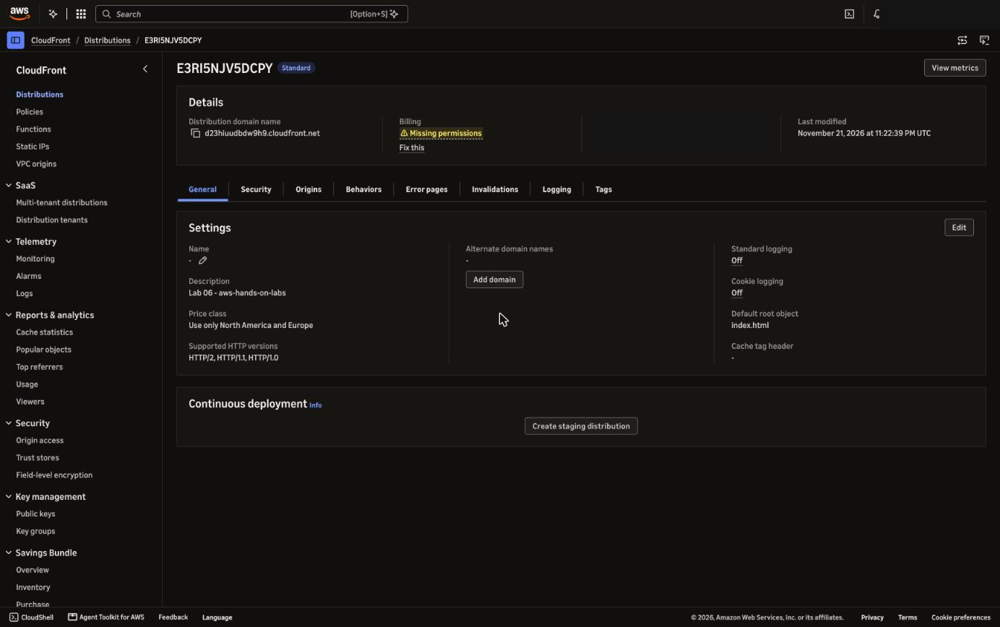
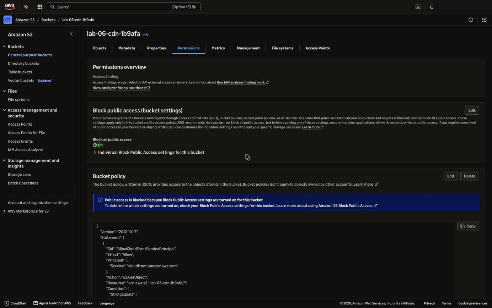
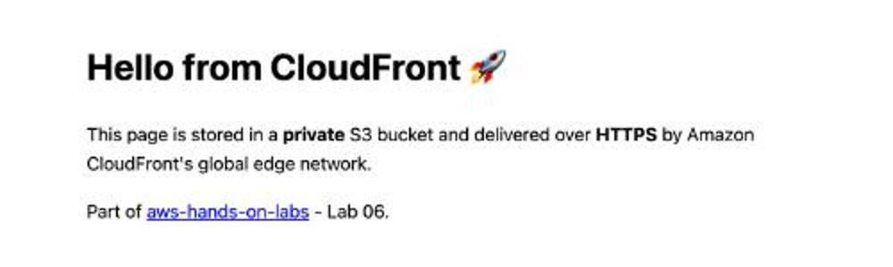

# 06 - CloudFront in Front of S3 (HTTPS + CDN)

**Level:** Beginner / Intermediate | **Time:** ~25 min (most of it waiting for CloudFront to deploy) | **Cost:** about $0 (CloudFront's free tier covers 1 TB/month and 10 M requests; cheapest price class used) | **Region:** bucket in `ap-southeast-2`; CloudFront is global

**Live site (HTTPS):** https://d23hiuudbdw9h9.cloudfront.net/ (`/nope` shows a custom 404)

## What you'll build
The upgrade to [Lab 04](../04-s3-static-website/README.md): the same kind of static site, but now **delivered over HTTPS by CloudFront's global network**, with the S3 bucket kept **completely private**. Only CloudFront is allowed to read from the bucket (Origin Access Control).

## Architecture
```
 browser ──HTTPS──▶ CloudFront edge location (cached) ──signed request (OAC)──▶ S3 bucket (PRIVATE)
   http:// is redirected to https://                     bucket policy: only THIS distribution may GetObject
   direct S3 URL → 403 Access Denied
```

## Services used
- [Amazon CloudFront](https://docs.aws.amazon.com/AmazonCloudFront/latest/DeveloperGuide/Introduction.html) - content delivery network
- [Origin Access Control](https://docs.aws.amazon.com/AmazonCloudFront/latest/DeveloperGuide/private-content-restricting-access-to-s3.html) - lets CloudFront, and only CloudFront, read a private bucket
- [Amazon S3](https://docs.aws.amazon.com/AmazonS3/latest/userguide/Welcome.html) - where the files live

## Prerequisites
AWS CLI configured. Site files: [`src/`](src/). Everything is automated by [`scripts/deploy.sh`](scripts/deploy.sh); output in [`sample-output.txt`](sample-output.txt).

## Why this is better than Lab 04
| | Lab 04 (S3 website) | Lab 06 (CloudFront + S3) |
|---|---|---|
| Protocol | HTTP only | **HTTPS** (certificate included) |
| Bucket | Public | **Private** |
| Speed | One region | Cached at edge locations worldwide |

## Steps
Screenshots were taken from the AWS console after the build (account ID and account name blacked out).

### Step 1 - Create a private bucket and upload the site
Leave **Block all public access ON**. This time nobody reads the bucket directly.
- **Console:** S3 → **Create bucket** (defaults) → **Upload** `src/index.html` and `src/error.html`
- **CLI:** `aws s3api create-bucket ...` then `aws s3 sync src/ s3://<bucket>/`

### Step 2 - Create an Origin Access Control (OAC)
- **Console:** CloudFront → **Security → Origin access → Create control setting** → Origin type *S3*, signing *Sign requests* → **Create**
- **CLI:** `aws cloudfront create-origin-access-control --origin-access-control-config ...`

### Step 3 - Create the CloudFront distribution
- **Console:** CloudFront → **Create distribution** → Origin: your S3 bucket → *Origin access: Origin access control settings* → pick the OAC → *Viewer protocol policy: Redirect HTTP to HTTPS* → Default root object `index.html` → Price class *North America and Europe only* → **Create distribution**. Under **Error pages** map error `403` to `/error.html` with response code `404`.
- **CLI:** `aws cloudfront create-distribution --distribution-config file://dist.json` (the JSON is built inside [`scripts/deploy.sh`](scripts/deploy.sh))
- Wait until the status is **Deployed** (3-6 minutes): `aws cloudfront wait distribution-deployed --id <id>`



### Step 4 - Allow only that distribution to read the bucket
The console offers a *Copy policy* button after Step 3. Paste it under S3 → bucket → **Permissions → Bucket policy**:
```json
{"Version":"2012-10-17","Statement":[{
  "Sid":"AllowCloudFrontServicePrincipal","Effect":"Allow",
  "Principal":{"Service":"cloudfront.amazonaws.com"},"Action":"s3:GetObject",
  "Resource":"arn:aws:s3:::<bucket>/*",
  "Condition":{"StringEquals":{"AWS:SourceArn":"arn:aws:cloudfront::<account-id>:distribution/<distribution-id>"}}}]}
```
The `Condition` is the important part: it ties access to **this one distribution** and not to CloudFront in general. Block Public Access stays **On**:


### Step 5 - Open the site
Open the `https://<id>.cloudfront.net/` address from the distribution page.


## Verify in AWS
- [ ] **HTTPS site works:** open https://d23hiuudbdw9h9.cloudfront.net/ → *"Hello from CloudFront"*
- [ ] **HTTP redirects to HTTPS:** `curl -sI http://d23hiuudbdw9h9.cloudfront.net/` → `301` with `Location: https://…`
- [ ] **Custom 404:** open `/nope` → *"404 - Page not found"* (HTTP 404)
- [ ] **It's cached:** `curl -sI https://d23hiuudbdw9h9.cloudfront.net/ | grep x-cache` → `Hit from cloudfront`
- [ ] **Bucket is private:** S3 → `lab-06-cdn-1b9afa` → Permissions → *Block all public access: On*; and `curl https://lab-06-cdn-1b9afa.s3.ap-southeast-2.amazonaws.com/index.html` returns **403**
- [ ] **Distribution is deployed:** CloudFront → distributions → status *Deployed*, enabled. CLI: `aws cloudfront get-distribution --id E3RI5NJV5DCPY --query Distribution.Status`

Command output captured from the live site: [`verify-output.txt`](verify-output.txt)

## Clean up
See [cleanup.md](cleanup.md). This lab is left running for demonstration; idle, it costs essentially nothing.

## What I learned / common errors
- **`AccessDenied` from CloudFront on a private bucket:** the bucket policy is missing or its `SourceArn` doesn't match the distribution. Both OAC *and* the policy are required.
- **Private S3 returns 403 (not 404) for missing files**, so I mapped CloudFront error `403` to a custom `404` page.
- **Changes aren't instant:** a distribution takes minutes to deploy, and cached files stay until they expire. Use an *invalidation* (`/*`) to force a refresh.
- **OAC replaces the older OAI.** OAC supports newer features and is what AWS recommends for new setups.
- **A distribution must be disabled before deletion**, and disabling also takes minutes, so the cleanup script waits.
- The `*.cloudfront.net` domain comes with a free HTTPS certificate. Your own domain needs a certificate from ACM (in `us-east-1`) and DNS (Lab 14).
