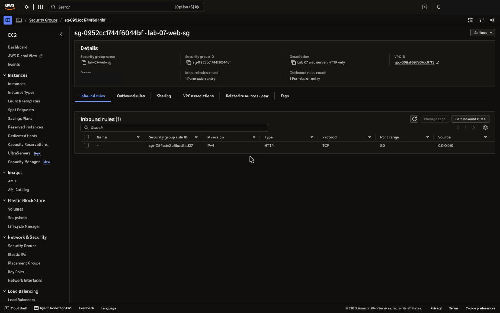
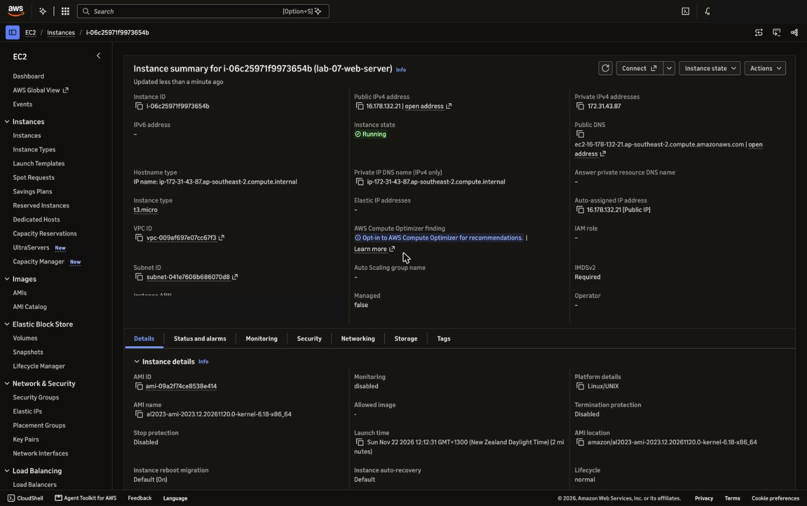

# 07 - EC2 Web Server

**Level:** Beginner | **Time:** ~20 min | **Cost:** `t3.micro` is about $0.01/hour (roughly $9/month while running); the free tier may cover it | **Region:** `ap-southeast-2` (Sydney)

**Live in AWS:** http://16.178.132.21/ (plain HTTP, running on instance `lab-07-web-server`). The public IP changes if the instance is stopped and started, so if the link is dead, use the Verify checklist.

## What you'll build
A real virtual server (EC2) that installs and starts the **nginx** web server by itself on first boot and serves a page showing which instance answered. It is locked down: only web traffic (port 80) is allowed in, no SSH port is open, and the modern metadata service (IMDSv2) is required.

## Architecture
```
 browser ──HTTP :80──▶ [Security group lab-07-web-sg: allow tcp/80 only]
                              │
                         EC2 t3.micro (Amazon Linux 2023, default VPC)
                         └─ user data on first boot: install nginx, write index.html
```

## Services used
- [Amazon EC2](https://docs.aws.amazon.com/ec2/) - virtual servers
- [Security groups](https://docs.aws.amazon.com/vpc/latest/userguide/vpc-security-groups.html) - the instance's firewall
- [EC2 user data](https://docs.aws.amazon.com/AWSEC2/latest/UserGuide/user-data.html) - a script that runs once at first boot
- [Instance metadata (IMDSv2)](https://docs.aws.amazon.com/AWSEC2/latest/UserGuide/configuring-instance-metadata-service.html) - how the instance learns about itself

## Prerequisites
AWS CLI configured and a **default VPC** in the region (new accounts have one). Code: [`src/user-data.sh`](src/user-data.sh).

## Steps
[`scripts/deploy.sh`](scripts/deploy.sh) runs everything; output in [`sample-output.txt`](sample-output.txt). Screenshots were taken from the AWS console after the build (account name and ID blacked out).

### Step 1 - Create the security group (the firewall)
Only allow web traffic. Note that **no port 22 (SSH)** is opened, so there is nothing to brute-force.
- **Console:** EC2 → **Security Groups → Create security group** → name `lab-07-web-sg` → default VPC → **Inbound rules → Add rule**: Type *HTTP*, Source *Anywhere-IPv4* → **Create**
- **CLI:**
```bash
aws ec2 create-security-group --group-name lab-07-web-sg --description "Lab 07 web server: HTTP only" --vpc-id <default-vpc>
aws ec2 authorize-security-group-ingress --group-id <sg> --protocol tcp --port 80 --cidr 0.0.0.0/0
```


### Step 2 - Launch the instance
- **Console:** EC2 → **Instances → Launch instances** → name `lab-07-web-server` → AMI *Amazon Linux 2023* → type *t3.micro* → *Proceed without a key pair* → Network settings: select existing security group `lab-07-web-sg` → **Advanced details**: *Metadata version* = *V2 only*, paste [`src/user-data.sh`](src/user-data.sh) into *User data* → **Launch instance**
- **CLI:**
```bash
aws ec2 run-instances --image-id <al2023-ami> --instance-type t3.micro --security-group-ids <sg> \
  --user-data file://src/user-data.sh --metadata-options HttpTokens=required,HttpEndpoint=enabled
```
The AMI ID comes from a public SSM parameter, so you always get the latest patched image: `aws ssm get-parameter --name /aws/service/ami-amazon-linux-latest/al2023-ami-kernel-default-x86_64`

The instance shows *Running*, with a public IPv4 address and *IMDSv2: Required*:


### Step 3 - Open the website
Wait about a minute for nginx to install, then open `http://<public-ip>/`.
```bash
curl http://<public-ip>/
```
The page shows the instance ID, Availability Zone and instance type, read from the metadata service. Output: [`sample-output.txt`](sample-output.txt).

## Verify in AWS
- [ ] **Live site:** open http://16.178.132.21/ → *"Hello from Amazon EC2"* with the instance ID `i-06c25971f9973654b`, zone `ap-southeast-2b`
- [ ] **Instance is running:** EC2 → Instances → `lab-07-web-server` → *Running*, type `t3.micro`. CLI: `aws ec2 describe-instances --filters Name=tag:Name,Values=lab-07-web-server --query 'Reservations[].Instances[].State.Name'`
- [ ] **Only HTTP is allowed in:** Security Groups → `lab-07-web-sg` → Inbound rules shows one rule, TCP 80
- [ ] **SSH is closed:** `nc -zv -w 3 16.178.132.21 22` times out (shown in [`verify-output.txt`](verify-output.txt))
- [ ] **IMDSv2 required:** instance details → *IMDSv2: Required*

## Clean up
See [cleanup.md](cleanup.md). **This lab costs money while running**, so terminate it when you're done showing it.

## What I learned / common errors
- **The site doesn't load right after launch:** user data takes a minute or two to finish. The deploy script polls until it gets HTTP 200.
- **Timeout vs refused:** a *timeout* means the security group is blocking you; *connection refused* means the firewall let you through but nothing is listening.
- **No SSH needed:** user data configures the server at boot. For access later use SSM Session Manager instead of opening port 22.
- **The public IP is not permanent.** It changes after a stop/start; an Elastic IP fixes that but is billed as a public IPv4 address.
- **A security group can't be deleted while an instance uses it.** Terminate the instance first.
- Browsers may warn on plain HTTP. A real site would use HTTPS (see Lab 06 for CloudFront).
