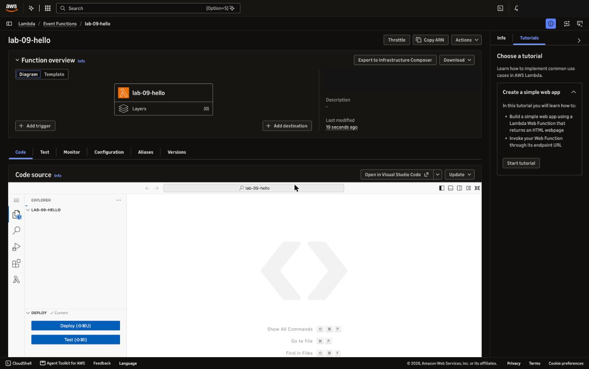

# 09 - Lambda Function

**Level:** Beginner | **Time:** ~15 min | **Cost:** $0 (Lambda free tier; one invocation) | **Region:** `ap-southeast-2`

## What you'll build
A small Python function that runs on demand with no server to manage. You give it a name and it returns a greeting, and its logs appear in CloudWatch automatically.

## Architecture
```
 you (CLI / console)  ──invoke──▶  Lambda: lab-09-hello  ──logs──▶  CloudWatch Logs
                                         │ assumes
                                         ▼
                              IAM role: lab-09-lambda-role
                              (AWSLambdaBasicExecutionRole = write logs only)
```

## Services used
- [AWS Lambda](https://docs.aws.amazon.com/lambda/latest/dg/welcome.html) - run code without servers
- [IAM roles](https://docs.aws.amazon.com/IAM/latest/UserGuide/id_roles.html) - the permissions the function runs with
- [CloudWatch Logs](https://docs.aws.amazon.com/AmazonCloudWatch/latest/logs/WhatIsCloudWatchLogs.html) - where `print()` output goes

## Prerequisites
AWS CLI configured and `zip` installed. Code: [`src/lambda_function.py`](src/lambda_function.py).

## Steps
Run [`scripts/deploy.sh`](scripts/deploy.sh); real output is in [`sample-output.txt`](sample-output.txt).

### 1. Create the execution role
A Lambda function needs a role it can assume. This one only allows writing logs (least privilege).
Console: [IAM → Roles → Create role](https://console.aws.amazon.com/iam/home#/roles) → AWS service → Lambda → `AWSLambdaBasicExecutionRole`
```bash
aws iam create-role --role-name lab-09-lambda-role --assume-role-policy-document file://trust.json
aws iam attach-role-policy --role-name lab-09-lambda-role \
  --policy-arn arn:aws:iam::aws:policy/service-role/AWSLambdaBasicExecutionRole
```

### 2. Create the function
Console: [Lambda → Create function](https://console.aws.amazon.com/lambda/home#/create/function) → Author from scratch → Python 3.13
```bash
zip -j function.zip src/lambda_function.py
aws lambda create-function --function-name lab-09-hello --runtime python3.13 \
  --handler lambda_function.lambda_handler --role <role-arn> --zip-file fileb://function.zip
```


### 3. Invoke it
Console: function → **Test** tab
```bash
aws lambda invoke --function-name lab-09-hello --payload '{"name":"AWS Portfolio"}' \
  --cli-binary-format raw-in-base64-out out.json && cat out.json
```
Result: `{"message": "Hello, AWS Portfolio! Greetings from AWS Lambda.", ...}` with `StatusCode 200`.

### 4. Read the logs
Console: function → **Monitor → View CloudWatch logs**
```bash
aws logs filter-log-events --log-group-name /aws/lambda/lab-09-hello
```
The log shows my `print()` line, plus a `REPORT` line: duration 1.7 ms, **billed 81 ms**, 31 MB used of 128 MB.

## Verify it works
`StatusCode 200`, no `FunctionError`, and the greeting contains the name I sent. See `sample-output.txt`.

## Clean up
See [cleanup.md](cleanup.md).

## What I learned / common errors
- **`The role defined for the function cannot be assumed by Lambda`:** the role was brand new. IAM is eventually consistent, so wait ~10 seconds before creating the function.
- **Billed duration (81 ms) is much longer than actual duration (1.7 ms):** billing includes the cold-start initialisation on the first call.
- Lambda creates the log group on first run; deleting the function does **not** delete it, so cleanup removes it explicitly.
- Give the function only the permissions it needs. Here that is logging and nothing else.
