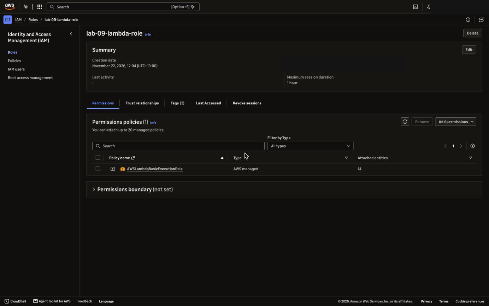
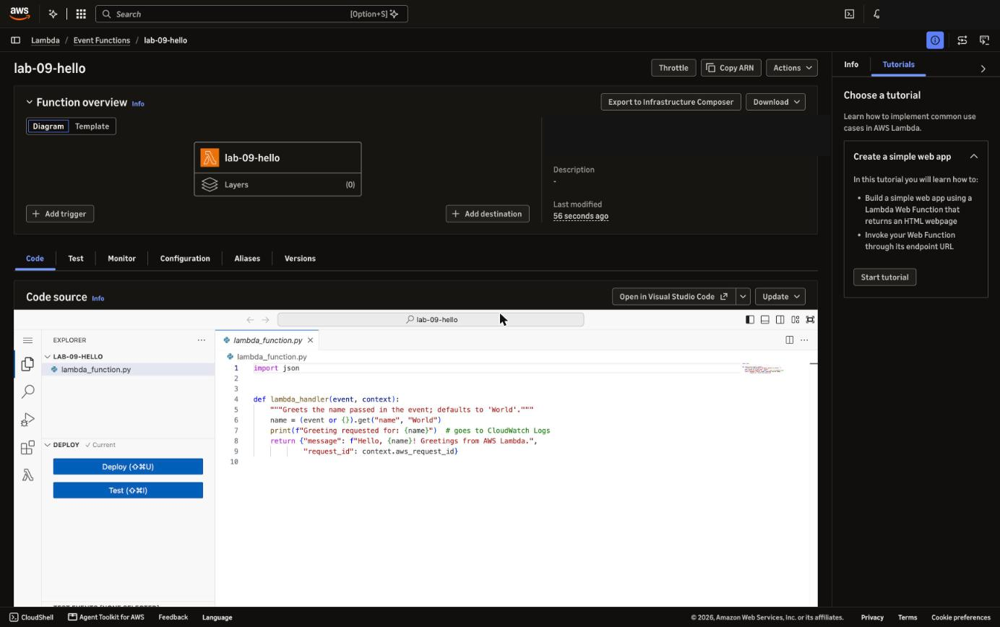
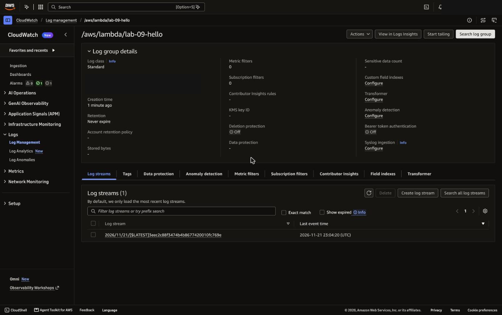

# 09 - Lambda Function

**Level:** Beginner | **Time:** ~15 min | **Cost:** $0 (Lambda free tier) | **Region:** `ap-southeast-2` (Sydney)

**Live in AWS:** function `lab-09-hello` and role `lab-09-lambda-role` (verify with the checklist below)

## What you'll build
A small Python function that runs on demand with no server to manage. You give it a name and it returns a greeting, and its logs appear in CloudWatch automatically.

## Architecture
```
 you (CLI / console)  ──invoke──▶  Lambda: lab-09-hello  ──logs──▶  CloudWatch Logs
                                         │ assumes
                                         ▼
                              IAM role: lab-09-lambda-role
                              (AWSLambdaBasicExecutionRole = write logs only)
```

## Services used
- [AWS Lambda](https://docs.aws.amazon.com/lambda/latest/dg/welcome.html) - run code without servers
- [IAM roles](https://docs.aws.amazon.com/IAM/latest/UserGuide/id_roles.html) - the permissions the function runs with
- [CloudWatch Logs](https://docs.aws.amazon.com/AmazonCloudWatch/latest/logs/WhatIsCloudWatchLogs.html) - where `print()` output goes

## Prerequisites
AWS CLI configured and `zip` installed. Code: [`src/lambda_function.py`](src/lambda_function.py).

## Steps
[`scripts/deploy.sh`](scripts/deploy.sh) runs steps 1-4. Real output is in [`sample-output.txt`](sample-output.txt). Screenshots were taken from the AWS console after each step (account name and ID blacked out).

### Step 1 - Create the execution role
A Lambda function needs a role it can assume. This one only allows writing logs (least privilege).
- **Console:** [IAM → Roles → Create role](https://console.aws.amazon.com/iam/home#/roles) → *AWS service* → *Lambda* → attach `AWSLambdaBasicExecutionRole` → name `lab-09-lambda-role` → **Create role**
- **CLI:**
```bash
aws iam create-role --role-name lab-09-lambda-role --assume-role-policy-document file://trust.json
aws iam attach-role-policy --role-name lab-09-lambda-role \
  --policy-arn arn:aws:iam::aws:policy/service-role/AWSLambdaBasicExecutionRole
```


### Step 2 - Create the function
- **Console:** [Lambda → Create function](https://console.aws.amazon.com/lambda/home#/create/function) → *Author from scratch* → name `lab-09-hello` → runtime *Python 3.13* → *Use an existing role* `lab-09-lambda-role` → **Create function** → paste the code → **Deploy**
- **CLI:**
```bash
zip -j function.zip src/lambda_function.py
aws lambda create-function --function-name lab-09-hello --runtime python3.13 \
  --handler lambda_function.lambda_handler --role <role-arn> --zip-file fileb://function.zip
```


### Step 3 - Invoke it
- **Console:** function → **Test** tab → event JSON `{"name": "AWS Portfolio"}` → **Test**
- **CLI:**
```bash
aws lambda invoke --function-name lab-09-hello --payload '{"name":"AWS Portfolio"}' \
  --cli-binary-format raw-in-base64-out out.json && cat out.json
```
Result: `{"message": "Hello, AWS Portfolio! Greetings from AWS Lambda.", ...}` with `StatusCode 200`.

### Step 4 - Read the logs
- **Console:** function → **Monitor** → **View CloudWatch logs**, or CloudWatch → Log groups → `/aws/lambda/lab-09-hello`
- **CLI:** `aws logs filter-log-events --log-group-name /aws/lambda/lab-09-hello`

The log shows my `print()` line plus a `REPORT` line: duration 1.86 ms, **billed 85 ms**, 31 MB used of 128 MB.


## Verify in AWS
- [ ] **Function exists and is Active:** Lambda → Functions → `lab-09-hello` (Sydney). CLI: `aws lambda get-function --function-name lab-09-hello --query Configuration.State` → `"Active"`
- [ ] **Runs and returns 200:** invoke it (Step 3). Output contains the name you sent. Anyone with access can run `aws lambda invoke ...`
- [ ] **Least-privilege role:** IAM → Roles → `lab-09-lambda-role` → exactly one policy, `AWSLambdaBasicExecutionRole`. CLI: `aws iam list-attached-role-policies --role-name lab-09-lambda-role`
- [ ] **Logs arrive:** CloudWatch → Log groups → `/aws/lambda/lab-09-hello` has a log stream containing `Greeting requested for: ...`

Command output captured from the live function: [`verify-output.txt`](verify-output.txt)

## Clean up
See [cleanup.md](cleanup.md). This lab is left running for demonstration.

## What I learned / common errors
- **`The role defined for the function cannot be assumed by Lambda`:** the role was brand new. IAM is eventually consistent, so wait ~10 seconds before creating the function.
- **Billed duration (85 ms) is much longer than actual duration (1.86 ms):** billing includes the cold-start initialisation on the first call.
- Lambda creates the log group on first run; deleting the function does **not** delete it, so cleanup removes it explicitly.
- **Stale log events:** after deleting and recreating a function, the log query can still return events from the old deployment for a while. The deploy script filters logs by the invocation's start time so it only shows the current run.
- Give the function only the permissions it needs. Here that is logging and nothing else.
