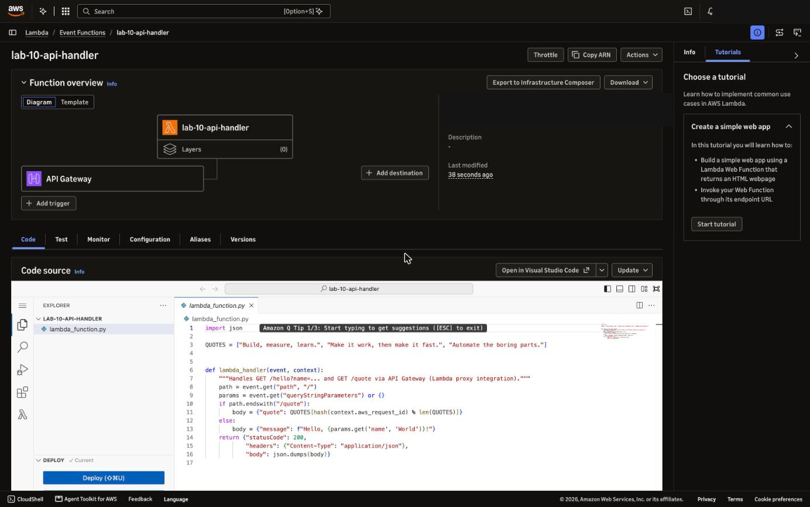
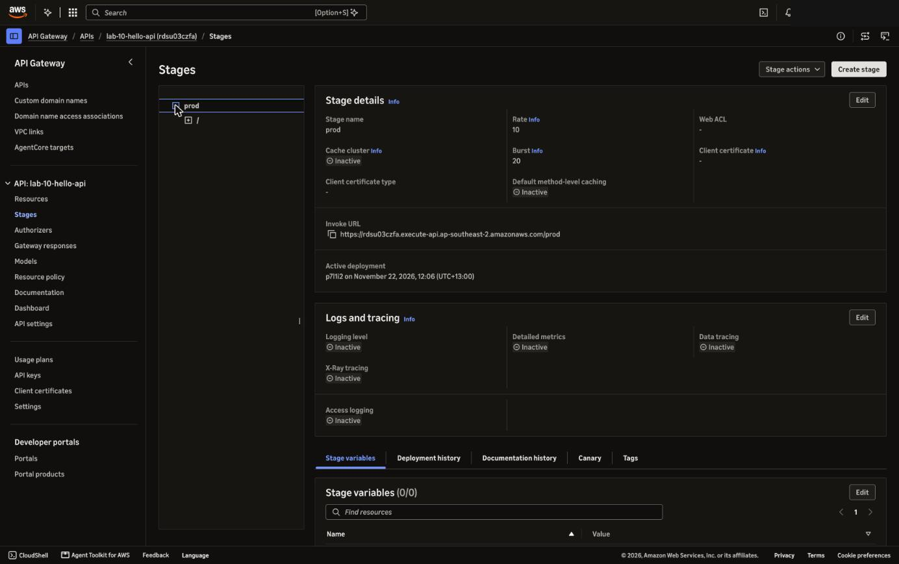

# 10 - Lambda + API Gateway REST API

**Level:** Beginner | **Time:** ~25 min | **Cost:** about $0 (free tier; stage is throttled to 10 req/s) | **Region:** `ap-southeast-2` (Sydney)

**Live API:** https://rdsu03czfa.execute-api.ap-southeast-2.amazonaws.com/prod/hello?name=YourName
Also try `/quote` and a bad path like `/missing`. It's public and has no authentication, because it's a demo with no data behind it.

## What you'll build
A public HTTPS REST API with two endpoints, `GET /hello?name=...` and `GET /quote`, backed by one Lambda function. This is the standard "serverless backend" pattern.

## Architecture
```
 client ──HTTPS──▶ API Gateway (REST, stage "prod") ──proxy──▶ Lambda ──▶ JSON response
                      /hello  GET                               │
                      /quote  GET                               └─ logs → CloudWatch
```

## Services used
- [Amazon API Gateway](https://docs.aws.amazon.com/apigateway/latest/developerguide/welcome.html) - the HTTP front door
- [AWS Lambda](https://docs.aws.amazon.com/lambda/latest/dg/welcome.html) - the code behind it (see [Lab 09](../09-lambda-function/README.md))
- [IAM](https://docs.aws.amazon.com/IAM/latest/UserGuide/introduction.html) - execution role + permission for API Gateway to call Lambda

## Prerequisites
AWS CLI configured. Code: [`src/lambda_function.py`](src/lambda_function.py).

## Steps
[`scripts/deploy.sh`](scripts/deploy.sh) runs everything; output is in [`sample-output.txt`](sample-output.txt). Screenshots were taken from the AWS console after each step (account name and ID blacked out).

### Step 1 - Create the role and the Lambda function
Same as [Lab 09](../09-lambda-function/README.md): an execution role with `AWSLambdaBasicExecutionRole`, then the function.
- **Console:** Lambda → Create function → `lab-10-api-handler`, Python 3.13, existing role `lab-10-lambda-role` → paste `src/lambda_function.py` → **Deploy**
- **CLI:** `aws lambda create-function --function-name lab-10-api-handler --runtime python3.13 --handler lambda_function.lambda_handler --role <role-arn> --zip-file fileb://function.zip`

### Step 2 - Create the REST API, resources and methods
- **Console:** [API Gateway → Create API → REST API → Build](https://console.aws.amazon.com/apigateway) → name `lab-10-hello-api` → **Create resource** `/hello` and `/quote` → on each **Create method** `GET` → integration *Lambda function* with **Lambda proxy integration ON** → pick `lab-10-api-handler`
- **CLI:**
```bash
aws apigateway create-rest-api --name lab-10-hello-api
aws apigateway create-resource --rest-api-id <id> --parent-id <root> --path-part hello
aws apigateway put-method --rest-api-id <id> --resource-id <rid> --http-method GET --authorization-type NONE
aws apigateway put-integration ... --type AWS_PROXY --integration-http-method POST --uri <lambda-invocation-arn>
```


### Step 3 - Let API Gateway invoke the function
Without this resource-based permission the API returns `500`. The console adds it for you; with the CLI you must do it:
```bash
aws lambda add-permission --function-name lab-10-api-handler --statement-id apigw-invoke \
  --action lambda:InvokeFunction --principal apigateway.amazonaws.com --source-arn <api-execute-arn>/*/GET/*
```
The Lambda console now shows API Gateway as a trigger:


### Step 4 - Deploy to a stage and throttle it
An API does nothing until it is **deployed** to a stage. Because this API is public and unauthenticated, I also cap it at 10 requests/s (burst 20).
- **Console:** **Deploy API** → *New stage* → `prod`. Then **Stages → prod → Stage details → Edit** → turn on *Custom throttling*: rate `10`, burst `20`.
- **CLI:**
```bash
aws apigateway create-deployment --rest-api-id <id> --stage-name prod
aws apigateway update-stage --rest-api-id <id> --stage-name prod --patch-operations \
  'op=replace,path=/*/*/throttling/rateLimit,value=10' 'op=replace,path=/*/*/throttling/burstLimit,value=20'
```
The invoke URL is `https://<api-id>.execute-api.ap-southeast-2.amazonaws.com/prod`.


### Step 5 - Call it
```bash
curl "https://<api-id>.execute-api.ap-southeast-2.amazonaws.com/prod/hello?name=Portfolio"
```
It also works in a browser:


## Verify in AWS
- [ ] **Live call works:** open the live API link above in a browser. You see `{"message": "Hello, <name>!"}`.
- [ ] **Both routes work:** `/quote` returns a quote (HTTP 200); `/missing` returns HTTP 403 `Missing Authentication Token`.
- [ ] **API exists:** API Gateway → APIs → `lab-10-hello-api` (Sydney) → Resources shows `/hello` and `/quote` with `GET`. CLI: `aws apigateway get-rest-apis --query "items[?name=='lab-10-hello-api'].name"`
- [ ] **Lambda is behind it:** Lambda → `lab-10-api-handler` → diagram shows **API Gateway** as a trigger. CLI: `aws lambda get-policy --function-name lab-10-api-handler`
- [ ] **Stage is deployed and throttled:** API Gateway → `lab-10-hello-api` → Stages → `prod` → Rate 10, Burst 20. CLI: `aws apigateway get-stage --rest-api-id <id> --stage-name prod`

Command output captured from the live API: [`verify-output.txt`](verify-output.txt)
```
GET /hello?name=Verifier -> {"message": "Hello, Verifier!"}          [HTTP 200]
GET /hello               -> {"message": "Hello, World!"}             [HTTP 200]
GET /quote               -> {"quote": "..."}                         [HTTP 200]
GET /missing             -> {"message":"Missing Authentication Token"} [HTTP 403]
```

## Clean up
See [cleanup.md](cleanup.md). This lab is left running for demonstration.

## What I learned / common errors
- **`Missing Authentication Token` (403):** API Gateway's confusing message for "no such route/method". Check the path and HTTP method. It is not an auth problem.
- **`Internal server error` (500) on a new API:** usually the missing `lambda:InvokeFunction` permission, or you didn't redeploy after changing the API.
- **Changes to an API are not live until you redeploy to the stage.**
- **Lambda proxy integration:** API Gateway passes the whole request to Lambda and expects `statusCode`, `headers` and a string `body` back.
- **Quote the `/*/*/` patch paths in the shell.** Unquoted, zsh expands them and the command fails with `no matches found`.
- A public, unauthenticated API should be throttled. A real API would also add an authorizer, an API key or Cognito.
