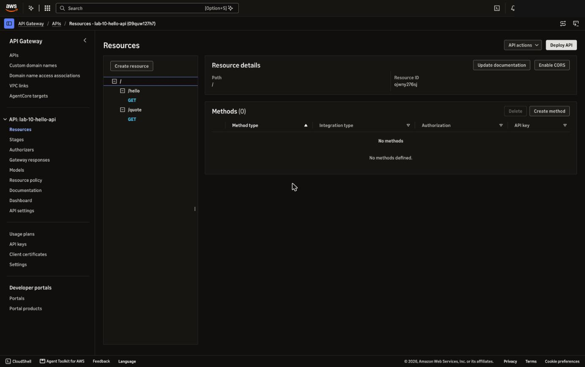

# 10 - Lambda + API Gateway REST API

**Level:** Beginner | **Time:** ~25 min | **Cost:** about $0 (free tier; a handful of requests) | **Region:** `ap-southeast-2`

## What you'll build
A public HTTPS REST API with two endpoints, `GET /hello?name=...` and `GET /quote`, backed by one Lambda function. This is the standard "serverless backend" pattern.

## Architecture
```
 client ──HTTPS──▶ API Gateway (REST, stage "prod") ──proxy──▶ Lambda ──▶ JSON response
                      /hello  GET                               │
                      /quote  GET                               └─ logs → CloudWatch
```

## Services used
- [Amazon API Gateway](https://docs.aws.amazon.com/apigateway/latest/developerguide/welcome.html) - the HTTP front door
- [AWS Lambda](https://docs.aws.amazon.com/lambda/latest/dg/welcome.html) - the code behind it (see [Lab 09](../09-lambda-function/README.md))
- [IAM](https://docs.aws.amazon.com/IAM/latest/UserGuide/introduction.html) - execution role + permission for API Gateway to call Lambda

## Prerequisites
AWS CLI configured. Code: [`src/lambda_function.py`](src/lambda_function.py).

## Steps
Run [`scripts/deploy.sh`](scripts/deploy.sh); output in [`sample-output.txt`](sample-output.txt).

### 1. Role and Lambda function
Same as Lab 09: an execution role with `AWSLambdaBasicExecutionRole`, then `create-function`.

### 2. Create the REST API, resources and methods
Console: [API Gateway → Create API → REST API](https://console.aws.amazon.com/apigateway) → **Create resource** `/hello` and `/quote` → **Create method** `GET` → integration type **Lambda function**, **Lambda proxy integration ON**.
```bash
aws apigateway create-rest-api --name lab-10-hello-api
aws apigateway create-resource --rest-api-id <id> --parent-id <root> --path-part hello
aws apigateway put-method --rest-api-id <id> --resource-id <rid> --http-method GET --authorization-type NONE
aws apigateway put-integration ... --type AWS_PROXY --integration-http-method POST --uri <lambda-invocation-arn>
```


### 3. Let API Gateway invoke the function
Without this resource-based permission the API returns `500`. The console adds it for you; with the CLI you must do it:
```bash
aws lambda add-permission --function-name lab-10-api-handler --statement-id apigw-invoke \
  --action lambda:InvokeFunction --principal apigateway.amazonaws.com --source-arn <api-execute-arn>/*/GET/*
```

### 4. Deploy to a stage
An API does nothing until it is **deployed** to a stage.
Console: **Deploy API → New stage → `prod`**
```bash
aws apigateway create-deployment --rest-api-id <id> --stage-name prod
```
The invoke URL is `https://<api-id>.execute-api.ap-southeast-2.amazonaws.com/prod`.

## Verify it works
Results from my run (full output in `sample-output.txt`):
```
GET /hello?name=Portfolio -> {"message": "Hello, Portfolio!"}            [HTTP 200]
GET /hello                -> {"message": "Hello, World!"}                [HTTP 200]
GET /quote                -> {"quote": "Build, measure, learn."}         [HTTP 200]
GET /missing              -> {"message":"Missing Authentication Token"}  [HTTP 403]
```

## Clean up
See [cleanup.md](cleanup.md).

## What I learned / common errors
- **`Missing Authentication Token` (403):** API Gateway's confusing message for "no such route/method". Check the path and HTTP method. It is not an auth problem.
- **`Internal server error` (500) on a new API:** usually the missing `lambda:InvokeFunction` permission, or you didn't redeploy after changing the API.
- **Changes to an API are not live until you redeploy to the stage.**
- **Lambda proxy integration:** API Gateway passes the whole request to Lambda and expects `statusCode`, `headers` and a string `body` back.
- This API has **no authentication** (fine for a demo). A real API would add an authorizer, an API key or Cognito, and throttling. I deleted it after testing.
