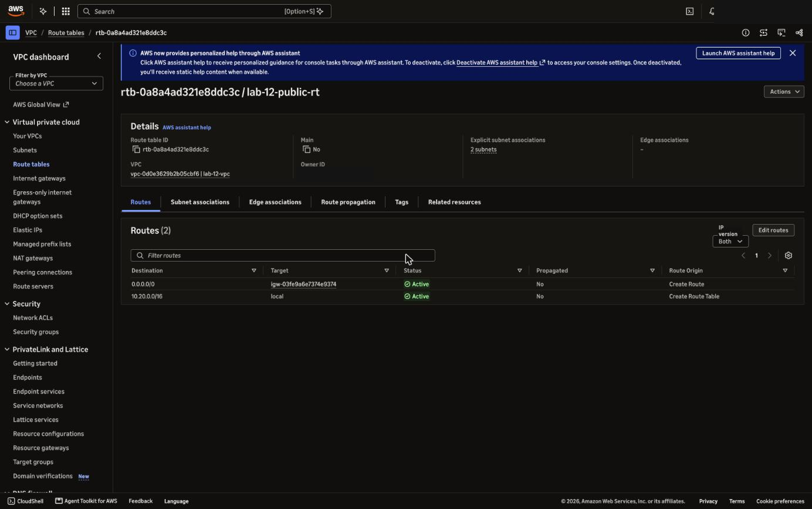
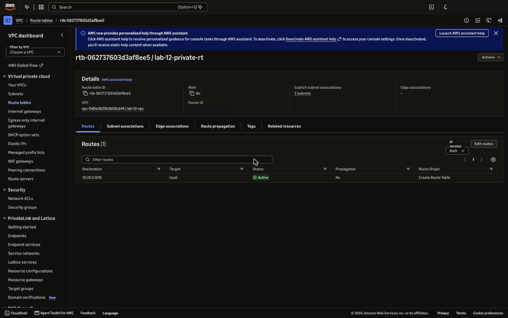
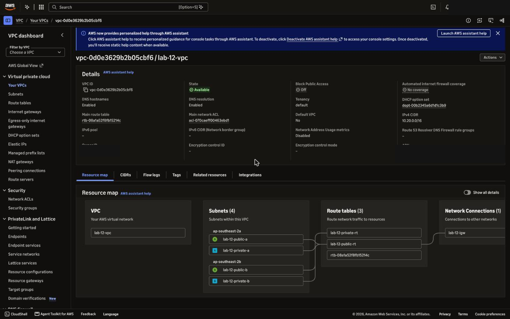

# 12 - Custom VPC (Public and Private Subnets)

**Level:** Intermediate | **Time:** ~30 min | **Cost:** $0 (VPCs, subnets, route tables and internet gateways are free; I deliberately left out the NAT Gateway, which costs about $0.045/hour) | **Region:** `ap-southeast-2` (Sydney)

**Live in AWS:** VPC `lab-12-vpc` (10.20.0.0/16) with 4 subnets in 2 Availability Zones (verify with the checklist below)

## What you'll build
Your own private network in AWS, the foundation for almost everything else: two **public** subnets (can reach the internet) and two **private** subnets (cannot), spread over two Availability Zones for resilience.

## Architecture
```
                         VPC 10.20.0.0/16  (lab-12-vpc)
   ┌──────────── ap-southeast-2a ────────────┐   ┌──────────── ap-southeast-2b ────────────┐
   │ public-a   10.20.1.0/24   ──┐           │   │ public-b   10.20.2.0/24   ──┐           │
   │ private-a  10.20.11.0/24 ─┐ │           │   │ private-b  10.20.12.0/24 ─┐ │           │
   └───────────────────────────┼─┼───────────┘   └───────────────────────────┼─┼───────────┘
                               │ └─▶ public route table  : 10.20.0.0/16 local, 0.0.0.0/0 ─▶ Internet Gateway
                               └───▶ private route table : 10.20.0.0/16 local only (no internet route)
```
*Where a NAT Gateway would go:* in a public subnet, with a route `0.0.0.0/0 → NAT` added to the private route table so private servers can reach out (updates, APIs) but nothing can reach in. I left it out to keep the lab free.

## Services used
- [Amazon VPC](https://docs.aws.amazon.com/vpc/latest/userguide/what-is-amazon-vpc.html) - your isolated virtual network
- [Subnets, route tables, internet gateways](https://docs.aws.amazon.com/vpc/latest/userguide/VPC_Route_Tables.html) - what makes a subnet "public" or "private"

## Prerequisites
AWS CLI configured. No code to write, just the script [`scripts/deploy.sh`](scripts/deploy.sh) (output in [`sample-output.txt`](sample-output.txt)).

## Key idea
A subnet is **public** only because its route table has a route to an **internet gateway**. There is no "public" checkbox on the subnet itself. "Private" just means no such route.

## Steps
Screenshots were taken from the AWS console after the build (account ID, owner and account name blacked out).

### Step 1 - Create the VPC
- **Console:** [VPC → Your VPCs → Create VPC](https://console.aws.amazon.com/vpcconsole/home#CreateVpc) → *VPC only* → name `lab-12-vpc`, IPv4 CIDR `10.20.0.0/16` → **Create VPC**; then **Actions → Edit VPC settings → Enable DNS hostnames**
- **CLI:**
```bash
aws ec2 create-vpc --cidr-block 10.20.0.0/16
aws ec2 modify-vpc-attribute --vpc-id <vpc> --enable-dns-hostnames '{"Value":true}'
```
`/16` gives 65,536 addresses. Pick a range that does not overlap your other networks.

### Step 2 - Create four subnets (two per Availability Zone)
- **Console:** VPC → **Subnets → Create subnet** → pick `lab-12-vpc` → add four subnets: `public-a 10.20.1.0/24` (AZ a), `public-b 10.20.2.0/24` (AZ b), `private-a 10.20.11.0/24` (AZ a), `private-b 10.20.12.0/24` (AZ b). For the two public ones: **Actions → Edit subnet settings → Enable auto-assign public IPv4 address**.
- **CLI:** `aws ec2 create-subnet --vpc-id <vpc> --cidr-block 10.20.1.0/24 --availability-zone ap-southeast-2a`

### Step 3 - Create and attach an internet gateway
- **Console:** VPC → **Internet gateways → Create internet gateway** `lab-12-igw` → **Actions → Attach to VPC**
- **CLI:** `aws ec2 create-internet-gateway` then `aws ec2 attach-internet-gateway --internet-gateway-id <igw> --vpc-id <vpc>`

### Step 4 - Make the public subnets public (route table)
- **Console:** VPC → **Route tables → Create route table** `lab-12-public-rt` → **Routes → Edit routes → Add route** destination `0.0.0.0/0`, target the internet gateway → **Subnet associations → Edit** → tick both public subnets
- **CLI:**
```bash
aws ec2 create-route --route-table-id <rtb> --destination-cidr-block 0.0.0.0/0 --gateway-id <igw>
aws ec2 associate-route-table --route-table-id <rtb> --subnet-id <public-subnet>
```


### Step 5 - Keep the private subnets private
Create `lab-12-private-rt` and associate the two private subnets. It has **only** the automatic `local` route, so traffic can stay inside the VPC but there is no way out to the internet.


### Step 6 - See the whole network
The VPC **Resource map** draws what you built: the VPC, four subnets by Availability Zone, the route tables and the internet gateway.


## Verify in AWS
- [ ] **VPC exists:** VPC → Your VPCs → `lab-12-vpc`, IPv4 CIDR `10.20.0.0/16`, state *Available*. CLI: `aws ec2 describe-vpcs --filters Name=tag:Name,Values=lab-12-vpc`
- [ ] **Four subnets in two AZs:** Resource map shows `public-a`, `private-a` (zone 2a) and `public-b`, `private-b` (zone 2b)
- [ ] **Public route table has an internet route:** `lab-12-public-rt` → Routes shows `0.0.0.0/0 → igw-…` and `10.20.0.0/16 → local`
- [ ] **Private route table has no internet route:** `lab-12-private-rt` → Routes shows only `10.20.0.0/16 → local`
- [ ] **Internet gateway attached:** VPC → Internet gateways → `lab-12-igw` → *Attached*
- [ ] **No NAT Gateway (no cost):** VPC → NAT gateways has none in this VPC

Command output captured from the live VPC: [`verify-output.txt`](verify-output.txt)

## Clean up
See [cleanup.md](cleanup.md). This lab costs nothing, so I left it running.

## What I learned / common errors
- **Public vs private is a routing decision**, not a subnet property. Moving a subnet between route tables changes its exposure.
- **Use two Availability Zones** so one data-centre failure doesn't take everything down. Real workloads place one copy of each tier per AZ.
- **Deletion order matters:** you can't delete a VPC while it has subnets or an attached internet gateway; the cleanup script removes things in dependency order.
- **Plan your CIDR ranges.** `10.20.0.0/16` won't conflict with the default VPC (`172.31.0.0/16`), which matters if you ever peer VPCs.
- **A NAT Gateway is the expensive part** of a "proper" VPC (about $33/month plus data). Alternatives for small setups: VPC endpoints for AWS services, or a NAT instance.
- The public IPv4 auto-assign setting only matters for instances launched into the subnet; the route to the internet gateway is what actually enables internet access.
