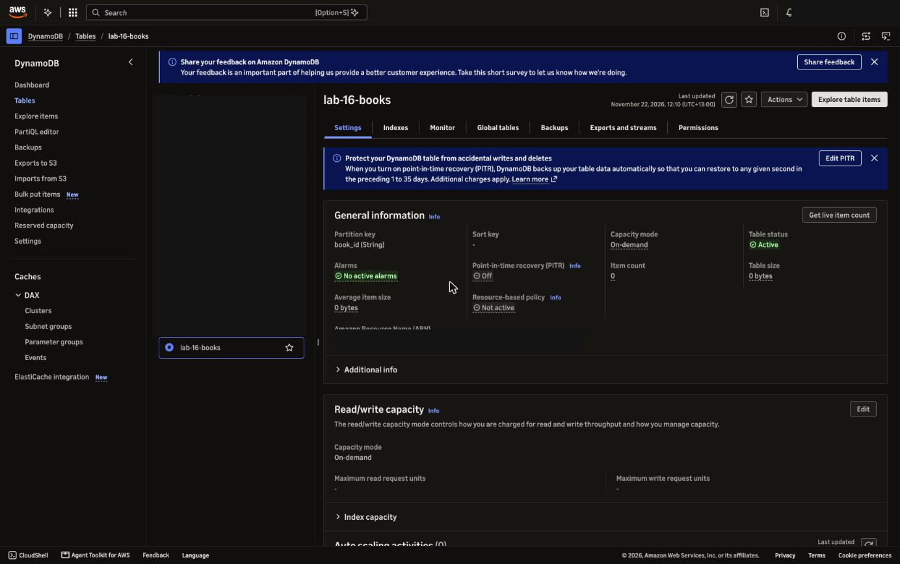
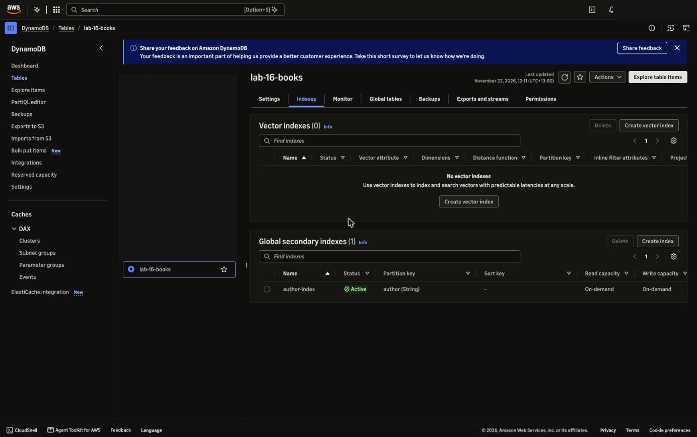
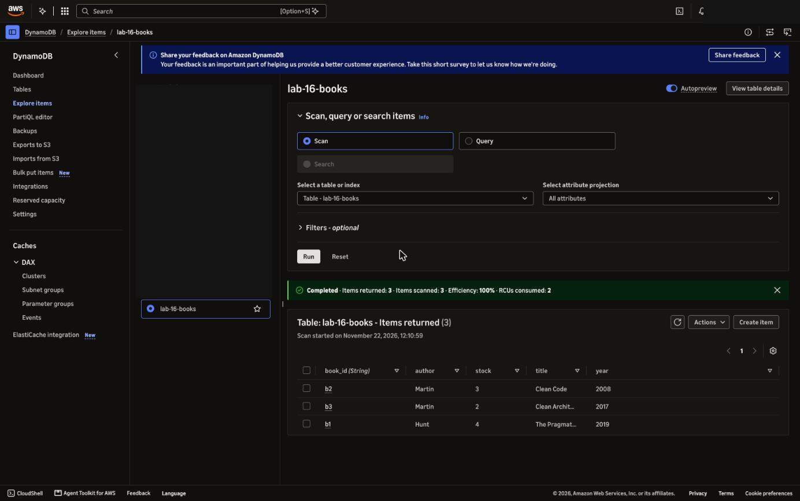

# 16 - DynamoDB CRUD with Python

**Level:** Beginner | **Time:** ~25 min | **Cost:** about $0 (on-demand billing; a handful of requests and a few bytes) | **Region:** `ap-southeast-2` (Sydney)

**Live in AWS:** table `lab-16-books` with 3 items and one global secondary index (verify with the checklist below)

## What you'll build
A NoSQL table of books and a Python program that does every basic operation: **C**reate, **R**ead, **U**pdate, **D**elete, plus a fast **query by author** through a secondary index.

## Architecture
```
 python src/crud.py ──boto3──▶ DynamoDB table lab-16-books
                                 key: book_id (String)
                                 └─ GSI author-index (key: author)  ← lets you query by author
```

## Services used
- [Amazon DynamoDB](https://docs.aws.amazon.com/amazondynamodb/latest/developerguide/Introduction.html) - serverless NoSQL database
- [boto3](https://boto3.amazonaws.com/v1/documentation/api/latest/index.html) - the AWS SDK for Python

## Prerequisites
AWS CLI configured, Python 3.9+ and `pip install -r requirements.txt`. Code: [`src/crud.py`](src/crud.py).

## Steps
Screenshots were taken from the AWS console after each step (account name and ID, and the names of other tables in the account, are blacked out).

### Step 1 - Create the table
- **Console:** [DynamoDB → Tables → Create table](https://console.aws.amazon.com/dynamodbv2/home#create-table) → name `lab-16-books` → partition key `book_id` (String) → **Customize settings** → capacity mode **On-demand** → under *Global secondary indexes* add `author-index` with partition key `author` (String) → **Create table**
- **CLI:** [`scripts/create_table.sh`](scripts/create_table.sh) (output in [`create-output.txt`](create-output.txt))
```bash
aws dynamodb create-table --table-name lab-16-books \
  --attribute-definitions AttributeName=book_id,AttributeType=S AttributeName=author,AttributeType=S \
  --key-schema AttributeName=book_id,KeyType=HASH --billing-mode PAY_PER_REQUEST \
  --global-secondary-indexes '[{"IndexName":"author-index","KeySchema":[{"AttributeName":"author","KeyType":"HASH"}],"Projection":{"ProjectionType":"ALL"}}]'
```
On-demand means you pay per request, with no capacity to plan.

*Item count shows 0 here because DynamoDB refreshes it only about every 6 hours. Use a Scan for the real count.*

The secondary index appears under **Indexes** once it is Active:


### Step 2 - Run the CRUD program
```bash
pip install -r requirements.txt
python src/crud.py
```
Each function in [`src/crud.py`](src/crud.py) maps to one operation:

| Operation | boto3 call | Notes |
|---|---|---|
| Create | `put_item` + `attribute_not_exists` | the condition refuses to overwrite an existing id |
| Read | `get_item` | single item by key, the fastest read |
| Update | `update_item` + `SET` | changes only the listed fields |
| Query | `query` on `author-index` | reads only matching items |
| Delete | `delete_item` | |
| Scan | `scan` | reads the whole table, so use sparingly |

Real output: [`crud-output.txt`](crud-output.txt)
```
CREATE  b1  The Pragmatic Programmer      (and b2, b3, b4)
READ    b1  ->  {... 'stock': Decimal('5') ...}
UPDATE  b1  ->  {'stock': Decimal('4'), ... 'year': Decimal('2019')}
QUERY   author='Martin'  ->  ['Clean Code', 'Clean Architecture']
DELETE  b4
CREATE  b1  -> rejected (already exists): conditional write protected the data
SCAN    3 items  ->  ['b1', 'b2', 'b3']
```

### Step 3 - See the data in the console
- **Console:** DynamoDB → **Explore items** → select `lab-16-books` → **Run**
- **CLI:** `aws dynamodb scan --table-name lab-16-books`

Three items remain: `b1` (updated to stock 4, year 2019), `b2` and `b3`. `b4` was deleted.


## Verify in AWS
- [ ] **Table exists and is Active:** DynamoDB → Tables → `lab-16-books` → *Table status: Active*, *Capacity mode: On-demand*. CLI: `aws dynamodb describe-table --table-name lab-16-books --query Table.TableStatus`
- [ ] **Index exists:** table → **Indexes** → `author-index` *Active*, partition key `author`
- [ ] **Three items:** Explore items → Run → `b1`, `b2`, `b3`. CLI: `aws dynamodb scan --table-name lab-16-books --select COUNT --consistent-read` → `"Count": 3`
- [ ] **Update worked:** `b1` shows `stock = 4`, `year = 2019`
- [ ] **Delete worked:** there is no item `b4`
- [ ] **Query by author works:** Explore items → **Query** → index `author-index` → `author = Martin` → *Clean Code* and *Clean Architecture*

Command output captured from the live table: [`verify-output.txt`](verify-output.txt)

## Clean up
See [cleanup.md](cleanup.md). This lab is left running for demonstration. An idle on-demand table costs essentially nothing.

## What I learned / common errors
- **Pick the partition key for how you read.** `book_id` is perfect for "get this book", but "all books by Martin" needs the secondary index. Without it you'd have to Scan.
- **Scan reads everything; Query reads only matches.** Query is cheaper and faster, so design indexes for your access patterns.
- **`ConditionalCheckFailedException` is a feature:** the condition expressions stopped a duplicate create from overwriting `b1`.
- **Numbers come back as `Decimal`**, not `int`. DynamoDB stores exact numbers, so convert if you need plain ints or JSON.
- **The console's Item count is stale** (refreshed about every 6 hours). Use a Scan for the true count.
- A new secondary index takes a few seconds to become Active, so wait before querying it.
