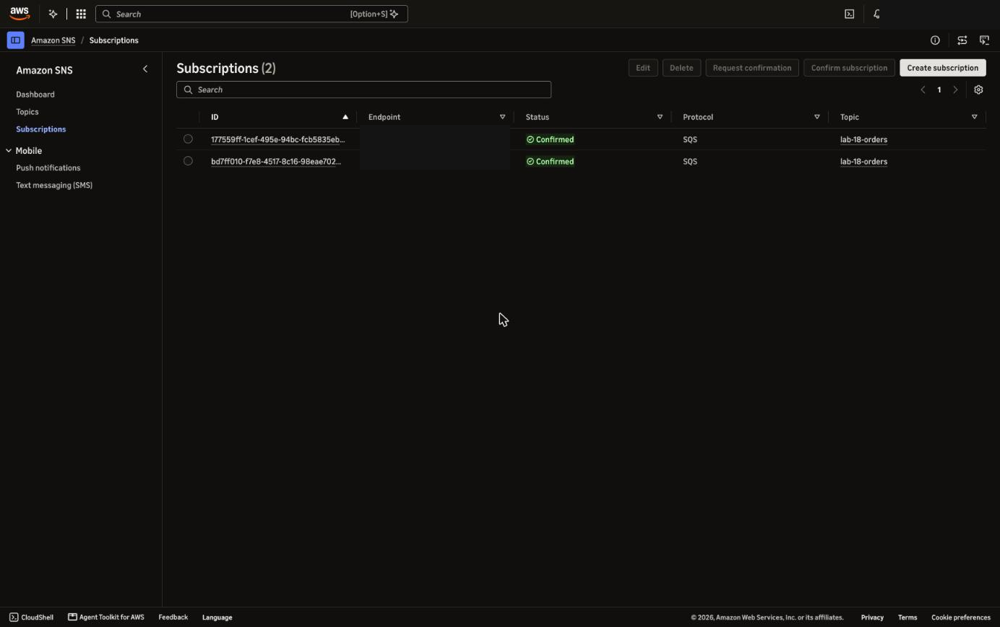
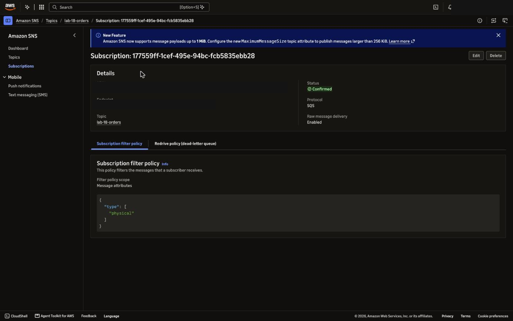
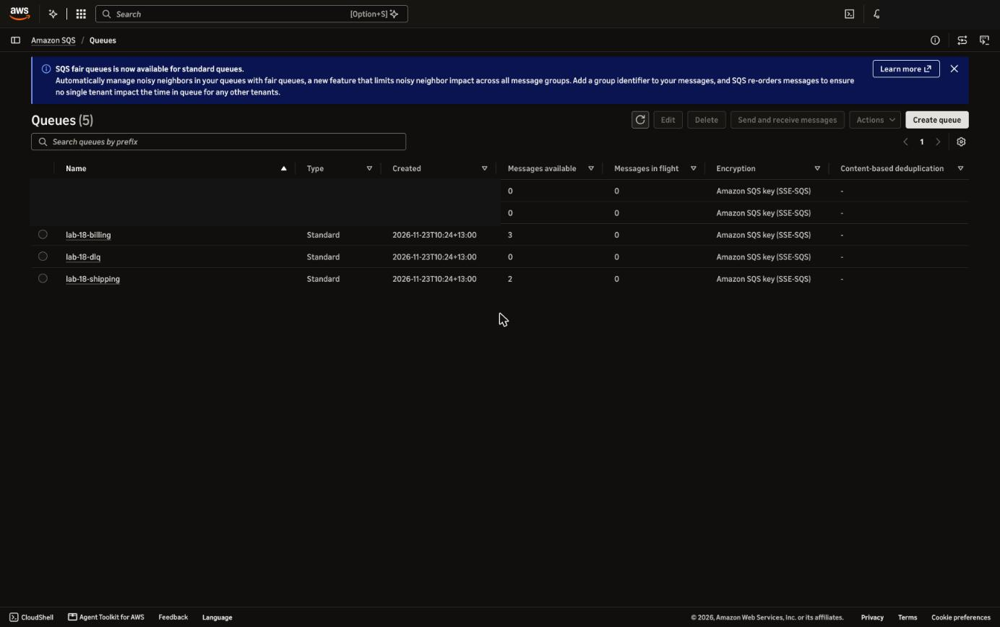

# 18 - SNS to SQS Fan-out with Filtering and a Dead-Letter Queue

**Level:** Intermediate | **Time:** ~30 min | **Cost:** about $0 (a few requests, well inside the free tier) | **Region:** `ap-southeast-2` (Sydney)

**Live in AWS:** topic `lab-18-orders`, queues `lab-18-billing`, `lab-18-shipping`, `lab-18-dlq` (verify with the checklist below)

## What you'll build
One "order placed" event is published once and delivered to two independent consumers. **Billing** receives every order. **Shipping** receives only physical orders (an e-book needs no shipping). A dead-letter queue catches messages that fail processing repeatedly.

## Architecture
```
                       ┌──────────────▶ SQS lab-18-billing   (all orders)
 publish ─▶ SNS topic ─┤                    │ after 3 failed receives
            lab-18-orders                   ▼
                       └─ filter type=physical ─▶ SQS lab-18-shipping ─▶ SQS lab-18-dlq
```

## Services used
- [Amazon SNS](https://docs.aws.amazon.com/sns/latest/dg/welcome.html) - publish/subscribe topics
- [Amazon SQS](https://docs.aws.amazon.com/AWSSimpleQueueService/latest/SQSDeveloperGuide/welcome.html) - message queues
- [SNS subscription filter policies](https://docs.aws.amazon.com/sns/latest/dg/sns-subscription-filter-policies.html)
- [SQS dead-letter queues](https://docs.aws.amazon.com/AWSSimpleQueueService/latest/SQSDeveloperGuide/sqs-dead-letter-queues.html)

## Prerequisites
AWS CLI configured. [`scripts/deploy.sh`](scripts/deploy.sh) runs every step below; real output is in [`sample-output.txt`](sample-output.txt). Screenshots come from the AWS console (account name and ID, and other projects' resources, are blacked out).

## Steps

### Step 1 - Create the dead-letter queue and the two work queues
- **Console:** [SQS → Create queue](https://console.aws.amazon.com/sqs/v3/home#/create-queue) → Standard → name `lab-18-dlq` → Create. Repeat for `lab-18-billing` and `lab-18-shipping`; in each, open **Dead-letter queue** → *Enabled* → choose `lab-18-dlq` → *Maximum receives* `3`.
- **CLI:**
```bash
aws sqs create-queue --queue-name lab-18-dlq
aws sqs create-queue --queue-name lab-18-billing --attributes RedrivePolicy='{"deadLetterTargetArn":"<dlq-arn>","maxReceiveCount":"3"}'
```
After 3 failed receives a message moves to the DLQ instead of looping forever.

### Step 2 - Create the topic
- **Console:** [SNS → Topics → Create topic](https://console.aws.amazon.com/sns/v3/home#/create-topic) → Standard → `lab-18-orders`
- **CLI:** `aws sns create-topic --name lab-18-orders`

### Step 3 - Let the topic write to the queues
A queue refuses messages from strangers. Each queue needs a policy allowing `sns.amazonaws.com` to `sqs:SendMessage`, limited by `aws:SourceArn` to this one topic (the console adds it for you when you subscribe; the CLI does not).
- **CLI:** `aws sqs set-queue-attributes --queue-url <url> --attributes Policy=<json>` (see [`scripts/deploy.sh`](scripts/deploy.sh))

### Step 4 - Subscribe both queues, filter shipping
- **Console:** topic → **Create subscription** → protocol *Amazon SQS* → endpoint = queue ARN → tick **Enable raw message delivery**. For shipping, expand **Subscription filter policy** → scope *Message attributes* → `{"type":["physical"]}`.
- **CLI:**
```bash
aws sns subscribe --topic-arn <topic> --protocol sqs --notification-endpoint <shipping-arn> \
  --attributes RawMessageDelivery=true,FilterPolicy='{"type":["physical"]}'
```


The shipping subscription's filter policy as stored by AWS:


### Step 5 - Publish three orders
```bash
aws sns publish --topic-arn <topic> --message '{"order":1001,"item":"keyboard"}' \
  --message-attributes '{"type":{"DataType":"String","StringValue":"physical"}}'
```
Orders: 1001 keyboard (physical), 1002 e-book (digital), 1003 monitor (physical).

### Step 6 - See the fan-out
- **Console:** [SQS → Queues](https://console.aws.amazon.com/sqs/v3/home#/queues) → *Messages available* column
- **CLI:** `aws sqs get-queue-attributes --queue-url <url> --attribute-names ApproximateNumberOfMessages`

Billing holds **3**, shipping holds **2**, the DLQ holds **0**:


## Verify in AWS
- [ ] **Queues exist:** SQS → Queues → `lab-18-billing`, `lab-18-shipping`, `lab-18-dlq`
- [ ] **Counts are 3 / 2 / 0:** *Messages available* column. CLI: `aws sqs get-queue-attributes --queue-url <billing-url> --attribute-names ApproximateNumberOfMessages`
- [ ] **Two Confirmed subscriptions:** SNS → Subscriptions → both `lab-18-orders`, protocol SQS
- [ ] **Filter policy on shipping:** open the shipping subscription → `{"type":["physical"]}`
- [ ] **DLQ wired up:** SQS → `lab-18-shipping` → *Dead-letter queue* tab → `lab-18-dlq`, max receives 3
- [ ] **Shipping has no e-book:** SQS → `lab-18-shipping` → **Send and receive messages** → **Poll for messages** shows only orders 1001 and 1003 (this makes messages temporarily invisible but does not delete them)

Command output captured from the live resources: [`verify-output.txt`](verify-output.txt)

## Clean up
See [cleanup.md](cleanup.md). This lab is left running for demonstration; idle queues cost nothing.

## What I learned / common errors
- **Fan-out = one publish, many consumers.** Each consumer gets its own queue, so one slow or failing consumer doesn't affect the other.
- **Filtering happens in SNS**, before delivery, so shipping never even stores the e-book order.
- **Without the queue policy, nothing arrives** and there is no error on publish. Always check the queue policy first.
- **Raw message delivery** gives the queue just your JSON, without the SNS envelope.
- **Peeking at a queue changes it.** My first demo read messages with a visibility timeout of 0; each read counts as a receive, so after 3 reads every shipping message went to the DLQ and the output showed order 1003 three times. Fix: use the normal visibility timeout when peeking, and read in a loop since one receive returns only a sample of messages. The deploy script has a comment about this.
- **SQS makes you wait ~60 seconds** before you can re-create a queue with a name you just deleted.
