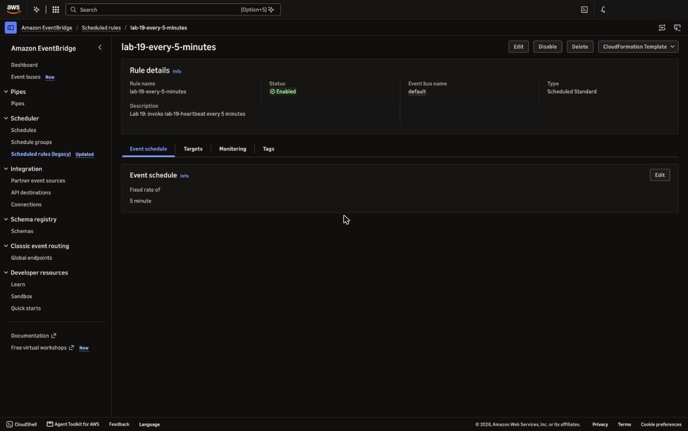
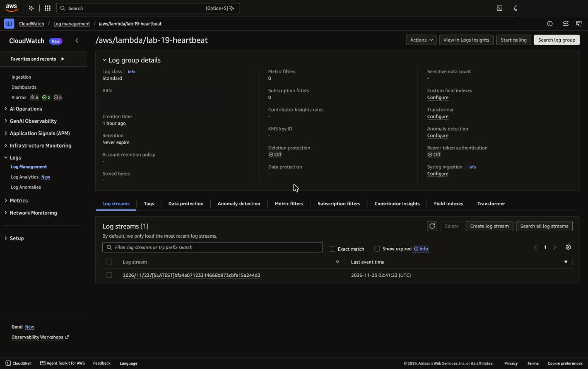
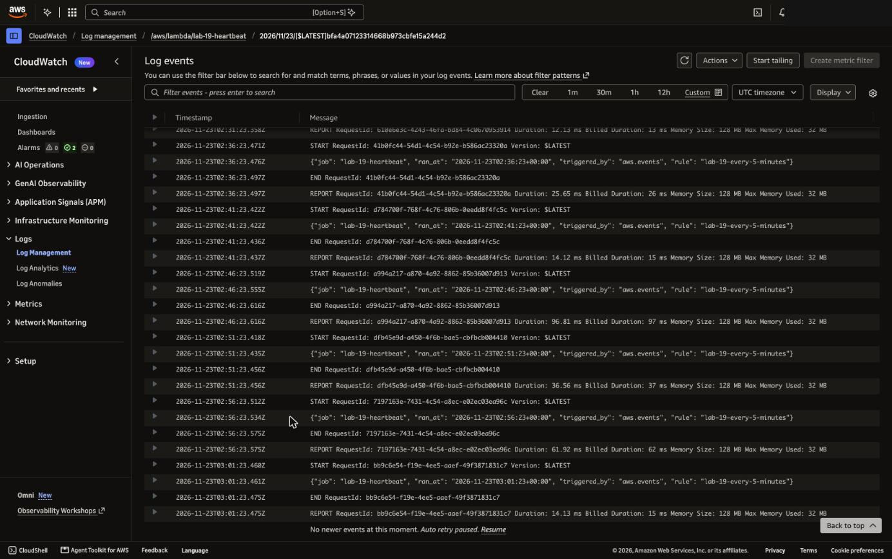

# 19 - Scheduled Job with EventBridge and Lambda

**Level:** Beginner | **Time:** ~20 min | **Cost:** about $0 (288 tiny invocations a day, far inside the free tier) | **Region:** `ap-southeast-2` (Sydney)

**Live in AWS:** rule `lab-19-every-5-minutes` and function `lab-19-heartbeat` (verify with the checklist below)

## What you'll build
A cron-style job with no server: Amazon EventBridge wakes a Lambda function every 5 minutes, and the function writes a log line each time. This is the standard pattern for nightly reports, cleanups and health checks.

## Architecture
```
 EventBridge rule ──every 5 min──▶ Lambda lab-19-heartbeat ──▶ CloudWatch Logs
 rate(5 minutes)                    │ assumes
                                    ▼
                          IAM role lab-19-lambda-role (logs only)
```

## Services used
- [Amazon EventBridge](https://docs.aws.amazon.com/eventbridge/latest/userguide/eb-what-is.html) - schedules and events
- [AWS Lambda](https://docs.aws.amazon.com/lambda/latest/dg/welcome.html) - the code that runs (see [Lab 09](../09-lambda-function/README.md))
- [CloudWatch Logs](https://docs.aws.amazon.com/AmazonCloudWatch/latest/logs/WhatIsCloudWatchLogs.html) - proof each run happened

## Prerequisites
AWS CLI configured and `zip` installed. Code: [`src/lambda_function.py`](src/lambda_function.py). [`scripts/deploy.sh`](scripts/deploy.sh) runs steps 1-4; output is in [`sample-output.txt`](sample-output.txt). Screenshots come from the AWS console (account name and ID blacked out).

## Steps

### Step 1 - Create the role and the function
Same as [Lab 09](../09-lambda-function/README.md): a role with only `AWSLambdaBasicExecutionRole`, then the function `lab-19-heartbeat` (Python 3.13).
- **Console:** IAM → Roles → Create role (Lambda, `AWSLambdaBasicExecutionRole`, name `lab-19-lambda-role`); Lambda → Create function → paste `src/lambda_function.py` → **Deploy**
- **CLI:** `aws lambda create-function --function-name lab-19-heartbeat --runtime python3.13 --handler lambda_function.lambda_handler --role <role-arn> --zip-file fileb://function.zip`

### Step 2 - Create the schedule
- **Console:** [EventBridge → Scheduled rules (legacy) → Create rule](https://console.aws.amazon.com/events/home#/rules/create) → name `lab-19-every-5-minutes` → *Schedule* → *Fixed rate of* `5` minutes → target *Lambda function* `lab-19-heartbeat` → **Create**
- **CLI:**
```bash
aws events put-rule --name lab-19-every-5-minutes --schedule-expression 'rate(5 minutes)' --state ENABLED
```
Cron works too, for example `cron(0 18 * * ? *)` is every day at 18:00 UTC.


### Step 3 - Allow EventBridge to call the function
The console does this for you; with the CLI you must add a resource-based permission, limited to this one rule:
```bash
aws lambda add-permission --function-name lab-19-heartbeat --statement-id eventbridge-invoke \
  --action lambda:InvokeFunction --principal events.amazonaws.com --source-arn <rule-arn>
```

### Step 4 - Attach the function as the rule's target
```bash
aws events put-targets --rule lab-19-every-5-minutes --targets "Id=heartbeat,Arn=<function-arn>"
```
Console: rule → **Targets** tab.

### Step 5 - Watch it run on its own
Wait 5-10 minutes. Nobody invokes the function; the schedule does.
- **Console:** CloudWatch → Log groups → `/aws/lambda/lab-19-heartbeat`
- **CLI:** [`scripts/verify.sh`](scripts/verify.sh)

A log group appears the first time the function runs:


Open the log stream: a new run every 5 minutes, and each log line says `"triggered_by": "aws.events"`:


## Verify in AWS
- [ ] **Rule is enabled:** EventBridge → Scheduled rules → `lab-19-every-5-minutes` → *Enabled*, *Fixed rate of 5 minute*. CLI: `aws events describe-rule --name lab-19-every-5-minutes`
- [ ] **Rule targets the function:** rule → **Targets** tab → `lab-19-heartbeat`. CLI: `aws events list-targets-by-rule --rule lab-19-every-5-minutes`
- [ ] **It runs by itself:** CloudWatch → Log groups → `/aws/lambda/lab-19-heartbeat` → log stream shows a new `lab-19-heartbeat` line every 5 minutes with `triggered_by: aws.events`
- [ ] **Metric agrees:** Lambda → `lab-19-heartbeat` → **Monitor** → *Invocations* is about 12 per hour
- [ ] **Permission is scoped:** CLI `aws lambda get-policy --function-name lab-19-heartbeat` shows principal `events.amazonaws.com` limited to this rule's ARN

Captured from the live resources: [`verify-output.txt`](verify-output.txt). It shows 17 consecutive runs exactly 5 minutes apart and an Invocations sum of 12 in the last hour.

## Clean up
See [cleanup.md](cleanup.md). **This lab keeps running every 5 minutes until you delete it.** The cost is about zero, but delete it when you no longer need the demo.

## What I learned / common errors
- **A rule with no permission does nothing, silently.** If the log group never appears, check the Lambda resource policy (Step 3).
- **Schedules are in UTC**, so a cron for "9am" needs converting.
- **`rate()` accepts singular/plural strictly:** `rate(1 minute)`, `rate(5 minutes)`. `rate(1 minutes)` is rejected.
- **Timing is not exact.** A rule fires within about a minute of its schedule; here the runs were `:23` past, five minutes apart.
- **EventBridge's newer "Scheduler" service** can also do this, with time zones and one-time schedules. This lab uses the classic rule because it is the most common in existing accounts.
- Deleting a rule requires removing its targets first, and deleting the function does not delete its log group; the cleanup script handles both.
