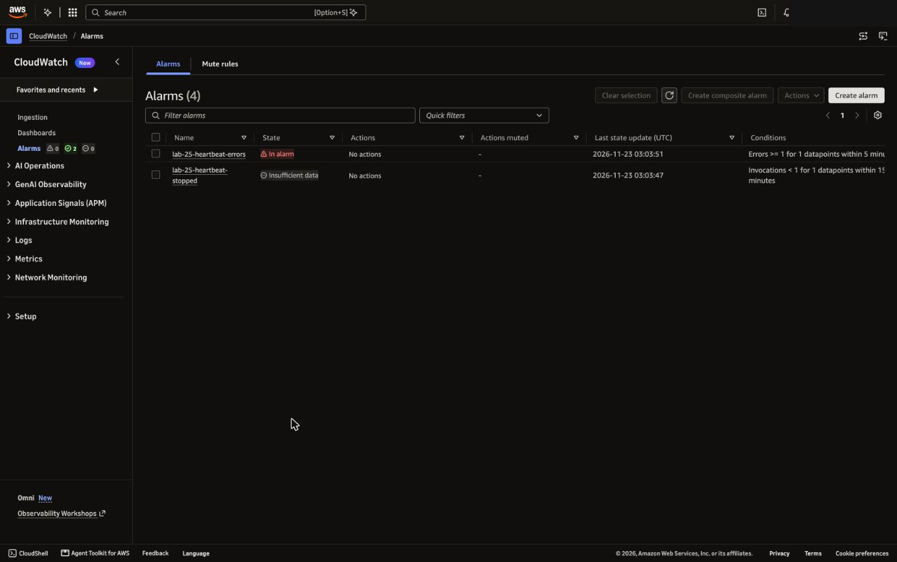
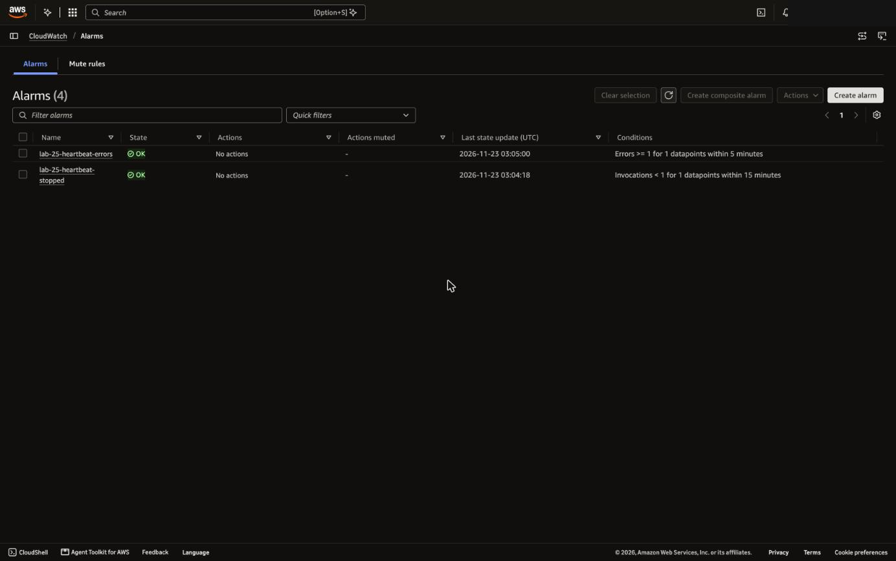
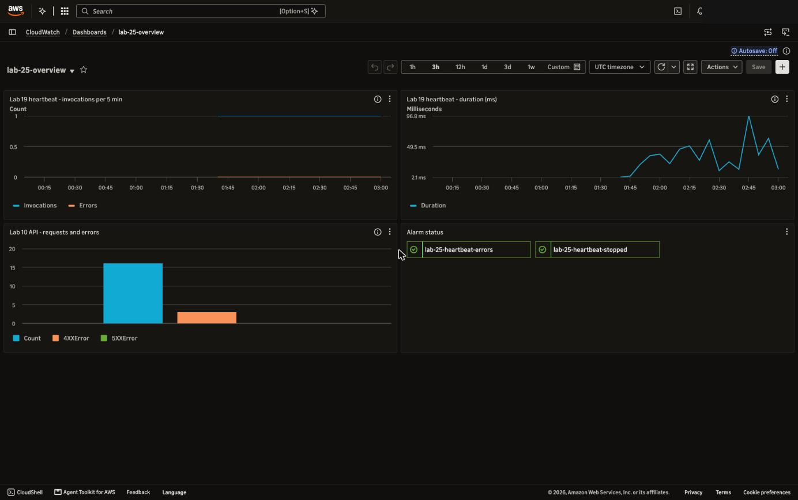

# 25 - CloudWatch Dashboard and Alarms

**Level:** Beginner | **Time:** ~25 min | **Cost:** about $0 (2 standard alarms and 1 dashboard are inside the free tier: 10 alarms, 3 dashboards) | **Region:** `ap-southeast-2` (Sydney)

**Live in AWS:** dashboard `lab-25-overview`, alarms `lab-25-heartbeat-stopped` and `lab-25-heartbeat-errors` (verify with the checklist below)

## What you'll build
Monitoring for the earlier labs: one dashboard showing the [Lab 19](../19-eventbridge-scheduled-lambda/README.md) scheduled function and the [Lab 10](../10-lambda-api-gateway/README.md) API, plus two alarms. One alarm is a **dead-man's switch** that fires if the heartbeat *stops* running; the other fires on errors.

## Architecture
```
 Lambda lab-19-heartbeat ─┐ metrics        ┌─▶ Dashboard lab-25-overview (graphs + alarm status)
 API Gateway lab-10  ─────┴─▶ CloudWatch ──┤
                                           └─▶ Alarm: Invocations < 1 in 15 min  (heartbeat stopped)
                                               Alarm: Errors >= 1 in 5 min       (heartbeat errors)
```

## Services used
- [Amazon CloudWatch metrics and alarms](https://docs.aws.amazon.com/AmazonCloudWatch/latest/monitoring/WhatIsCloudWatch.html)
- [CloudWatch dashboards](https://docs.aws.amazon.com/AmazonCloudWatch/latest/monitoring/CloudWatch_Dashboards.html)

## Prerequisites
Labs 19 and 10 deployed (they provide the metrics). Files: [`src/dashboard.json`](src/dashboard.json), [`scripts/deploy.sh`](scripts/deploy.sh); output in [`sample-output.txt`](sample-output.txt). Screenshots come from the AWS console (account name and ID blacked out).

## Steps

### Step 1 - Create the "heartbeat stopped" alarm
- **Console:** [CloudWatch → Alarms → Create alarm](https://console.aws.amazon.com/cloudwatch/home#alarmsV2:create) → **Select metric** → Lambda → By Function Name → `lab-19-heartbeat` / `Invocations` → Statistic **Sum**, period **15 minutes** → Threshold type *Static*, **Lower than** `1` → *Additional configuration* → Missing data treatment **Treat missing data as bad (breaching)** → name `lab-25-heartbeat-stopped` → Create (skip notifications for now)
- **CLI:**
```bash
aws cloudwatch put-metric-alarm --alarm-name lab-25-heartbeat-stopped \
  --namespace AWS/Lambda --metric-name Invocations --dimensions Name=FunctionName,Value=lab-19-heartbeat \
  --statistic Sum --period 900 --evaluation-periods 1 --threshold 1 \
  --comparison-operator LessThanThreshold --treat-missing-data breaching
```
Why "missing = breaching": if the schedule dies, the metric stops reporting. A normal alarm would sit at "no data" and never warn you.

### Step 2 - Create the "errors" alarm
Same flow with metric `Errors`, **Greater/Equal** `1`, period 5 minutes, missing data *not breaching* (no errors means no data points).
```bash
aws cloudwatch put-metric-alarm --alarm-name lab-25-heartbeat-errors --namespace AWS/Lambda --metric-name Errors \
  --dimensions Name=FunctionName,Value=lab-19-heartbeat --statistic Sum --period 300 --evaluation-periods 1 \
  --threshold 1 --comparison-operator GreaterThanOrEqualToThreshold --treat-missing-data notBreaching
```

### Step 3 - Prove an alarm can fire
Healthy systems never trip alarms, so test it by forcing the state:
```bash
aws cloudwatch set-alarm-state --alarm-name lab-25-heartbeat-errors --state-value ALARM --state-reason "Lab 25 manual test"
```
The console shows **In alarm**:


CloudWatch re-evaluates the real metric within about a minute and sets it back to **OK**. The alarm history records both changes (see [`verify-output.txt`](verify-output.txt)):


### Step 4 - Build the dashboard
- **Console:** [CloudWatch → Dashboards → Create dashboard](https://console.aws.amazon.com/cloudwatch/home#dashboards:) → `lab-25-overview` → add widgets: *Line* (Lambda Invocations and Errors), *Line* (Duration), *Bar* (API Gateway Count, 4XXError, 5XXError), *Alarm status*
- **CLI:** the whole dashboard is JSON, which makes it reviewable and repeatable: [`src/dashboard.json`](src/dashboard.json)
```bash
aws cloudwatch put-dashboard --dashboard-name lab-25-overview --dashboard-body file://dashboard.json
```
I sent 16 requests to the Lab 10 API (3 to bad paths, which return 403). The bar widget shows 16 requests and 3 client errors, the Lambda graphs show a run every 5 minutes, and the alarm widget is green:


## Verify in AWS
- [ ] **Alarms exist:** CloudWatch → Alarms → `lab-25-heartbeat-stopped` and `lab-25-heartbeat-errors`, both **OK**. CLI: `aws cloudwatch describe-alarms --alarm-name-prefix lab-25-`
- [ ] **The alarm really fired once:** alarm → **History** tab → *INSUFFICIENT_DATA → ALARM* then *ALARM → OK*. CLI: `aws cloudwatch describe-alarm-history --alarm-name lab-25-heartbeat-errors`
- [ ] **Dashboard exists:** CloudWatch → Dashboards → `lab-25-overview` with four widgets
- [ ] **Data is live:** the Lambda invocations graph keeps showing 1 per 5 minutes
- [ ] **Dead-man's switch config:** alarm → *Missing data treatment: breaching*

Captured output: [`verify-output.txt`](verify-output.txt)

## Clean up
See [cleanup.md](cleanup.md). Left running for demonstration; idle alarms and one dashboard are free-tier.

## What I learned / common errors
- **Missing data is a state of its own.** Choose how each alarm treats it: *breaching* for "this must keep happening", *not breaching* for "errors are rare events".
- **A new alarm starts in `INSUFFICIENT_DATA`** until it has evaluated one period.
- **Test alarms with `set-alarm-state`.** It is overwritten at the next evaluation, which is exactly what the history shows.
- **These alarms have no action**, so nothing is sent when they fire. A real setup adds an SNS topic with an email subscription (needs a real address, see [Lab 18](../18-sqs-sns-fanout/README.md) for SNS).
- **A line chart cannot draw one data point.** My API widget showed "No data available" until I switched it to a bar chart. The data was there, there was just a single point.
- **API Gateway metrics lag a few minutes** behind the requests.
- **Dashboard alarm widgets need full alarm ARNs**, not names.
- **zsh gotcha:** `$ACCOUNT:alarm` is read as a `:a` path modifier. Write `${ACCOUNT}:alarm` when building ARNs in zsh.
